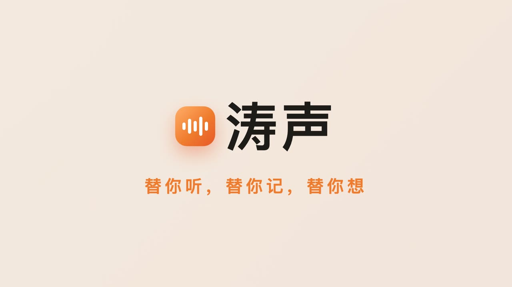
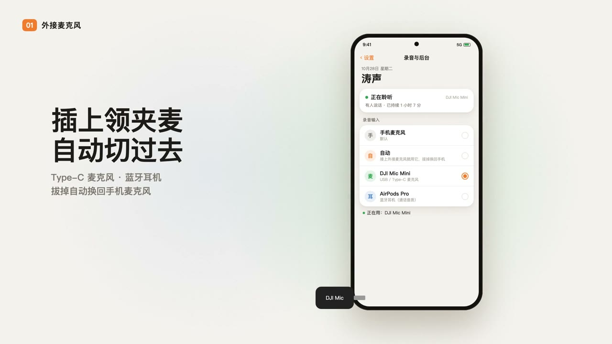
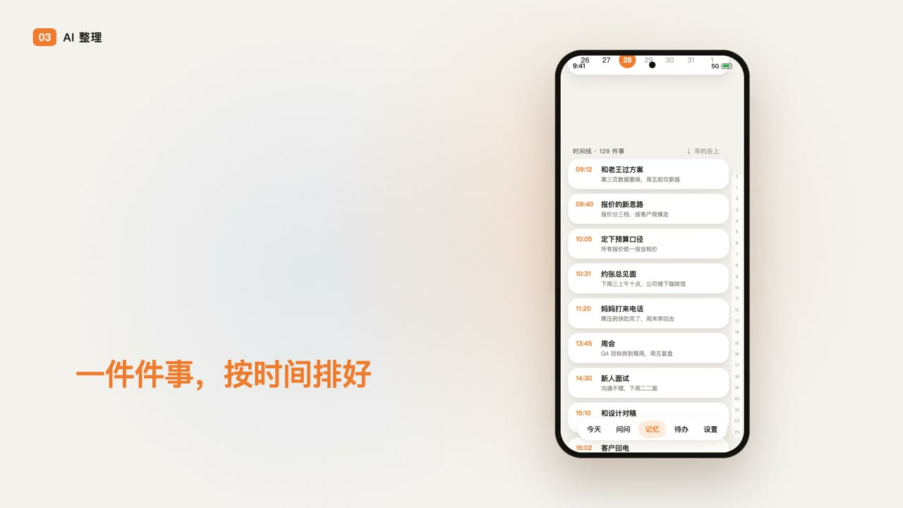
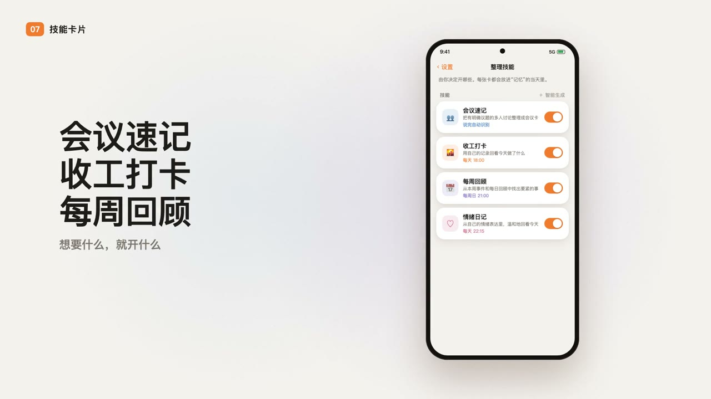
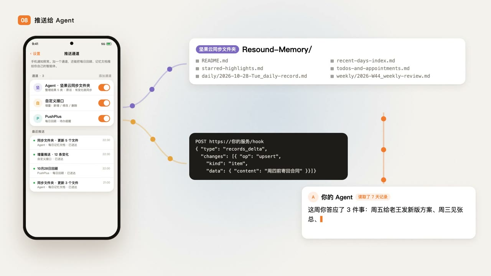
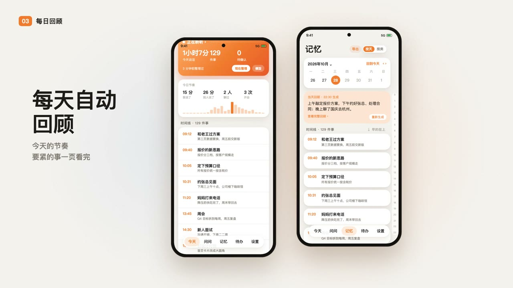
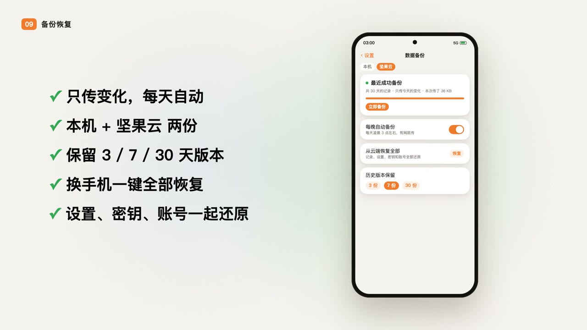
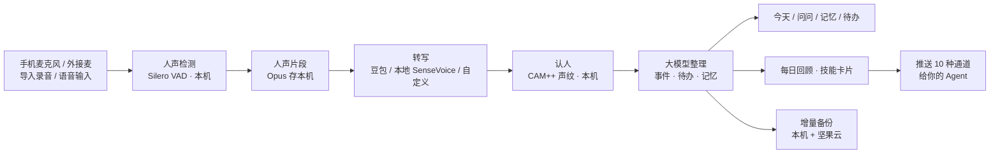

<div align="center">



# 涛声 TaoSheng

**替你听，替你记，替你想。**

一部安卓手机就够：全天收音 → 自动转写 → 认出谁在说 → AI 整理成待办、约定和记忆。<br>
不用买硬件，不用注册账号，数据只在你自己手机里。

[](LICENSE)


[](https://github.com/0xCoach/TaoSheng/stargazers)

[](https://github.com/0xCoach/TaoSheng/releases/download/v0.2.0/TaoSheng-v0.2.0-arm64.apk)

简体中文 | [English](README_EN.md)

</div>

---

## 🎬 一分半看懂涛声

<div align="center">

<a href="docs/media/taosheng-film.mp4"></a>

👉 **[点这里看完整宣传片（1 分 45 秒，带配乐）](docs/media/taosheng-film.mp4)**

</div>

## 💡 为什么做涛声

每天你说了几千句话，还记得几句？

- 开会时答应的事，转头就忘；
- 朋友随口说的电话号码、约好的时间，过两天想不起来；
- 灵感说过好几次，从来没记下来。

市面上的方案要么得买录音硬件（Omi、各种 AI 吊坠、录音卡片），要么把你的声音全部传到别人的服务器上。

**涛声的思路很简单：手机本来就随身，麦克风本来就在。** 让它安安静静地在后台听，有人说话才录；隔一阵子统一转成文字，认出是谁说的，再交给大模型整理成一件件事。你需要时，打字问一句就能找回来，答案附着原话出处。

## ✨ 亮点

1. **🎙 不用买任何硬件**：手机麦克风就够；也支持领夹麦、蓝牙耳机等外接设备，插上自动切换，拔掉自动切回。
2. **📴 本地模型完全离线转写**：可选 SenseVoice 本地识别（骁龙 NPU 加速），声音不出手机、不花一分钱；也可用豆包云端或自定义转写服务。
3. **⏱ 自动转写 + 自动整理，时间自己定**：转写间隔可设 15～720 分钟，转完自动整理成事件；每日回顾时间、技能运行时间都可调。
4. **🧑‍🤝‍🧑 声纹认人，分得清多个说话人**：本机声纹认出“我”和熟人，多人会议自动分段；在原话上长按选“这是谁”，指定一次就能学会这个人的声音。
5. **✅ 自动摘出待办**：原话里答应的事、约好的时间自动变成待办；你说一句“发了”，它就知道这件事做完了。
6. **🃏 每天自动生成任务卡，技能随你定义**：会议速记、收工打卡、每周回顾、情绪日记开箱即用；写一份 JSON + 提示词就能加自己的技能。
7. **💬 AI 问问，附原话出处**：哪天说过什么、答应过谁什么，直接打字问；每个答案都能点回当时的原话。
8. **🤖 原话和整理结果自动推给你的 Agent**：每天的原话 + 整理后的文本（Markdown + JSON）自动推到 10 种通道，只推新增 / 修改 / 删除，随时给你的 Agent 调用。
9. **☁️ 每天自动备份到坚果云和本机**：增量备份，只传变化；保留 3 / 7 / 30 天版本；换手机一键恢复，设置和密钥一起回来。
10. **🧠 整理模型随便换，可完全本地运行**：支持任何 OpenAI 兼容接口，填上你自建的模型地址，转写 + 整理全程不出你自己的设备。
11. **🔒 锁屏、后台一直在听**：前台服务 + 守护，被系统杀掉自动拉起；通知栏快捷开关一键暂停。
12. **🔋 只录人声，安静不录**：本机人声检测（Silero VAD），实测自身耗电约 0.5%/小时。
13. **📺 外放时不转写**：手机在放视频、音乐时自动跳过，不把视频里的话当成你说的；别的应用要用麦克风（电话、语音消息）时自动让出。
14. **⌨️ 语音输入也记得**（可选）：在微信等应用用输入法语音输入时，记下你说的话和当时的聊天上下文，分得清哪句是你、哪句是对方；截图只在内存里识字，识完即丢。
15. **🌙 每日 / 每周自动回顾**：一句话总结、要紧的事、待办、值得留意、灵感和心力，生成后推送给你。
16. **🔁 重复的灵感自动合并**：反复提到的想法合成一条，显示“说过 N 次”，真正在意的事一眼看出来。
17. **🔤 热词纠错**：人名、公司名、行业词设一次，转写更准。
18. **📂 导入录音文件**：会议录音、语音备忘从别的应用“分享到涛声”，一样转写、认人、整理。
19. **🗂 时间轴回看 + 重点标记**：拖一下回到当天任何时刻；左滑标 ★ 重点、右滑删除，可批量编辑。
20. **🔐 隐私优先**：不用注册账号、没有我们的服务器；密钥存系统安全区；录音转写后 24 小时自动删；“删除最近 N 分钟”“这段别记”一键彻底删除。
21. **👀 不隐藏**：常驻通知和系统麦克风绿点始终可见——它是你的记忆助手，不是窃听器。

<table>
<tr>
<td width="50%"></td>
<td width="50%"></td>
</tr>
<tr>
<td><b>🎙 全天在听，锁屏也不停</b><br>后台常驻 + 守护进程，被系统杀掉会自动拉起；只在有人说话时录，安静时不录，省电。</td>
<td><b>🧑‍🤝‍🧑 认得出谁在说</b><br>本机声纹认出“我”，也认得熟人；长按原话选“这是谁”，指定一次就记住这个人的声音。</td>
</tr>
<tr>
<td></td>
<td></td>
</tr>
<tr>
<td><b>🧠 AI 整理成一件件事</b><br>说过的话自动变成事件、待办、约定、决定和灵感，按时间排好，关键信息一眼看到。</td>
<td><b>💬 直接问，答案附原话</b><br>“上周我答应老王什么了？”——大模型带查询工具去翻你的记忆，每个结论都能点回原话。</td>
</tr>
<tr>
<td></td>
<td></td>
</tr>
<tr>
<td><b>🃏 技能卡片，按你的方式整理</b><br>会议速记、收工打卡、每周回顾、情绪日记……每个技能就是一份提示词，可以自己写。</td>
<td><b>🤖 推给你的 Agent</b><br>每天的记忆打包成 Markdown + JSON 推出去，只推新增 / 修改 / 删除，方便你自己的 AI 再加工。</td>
</tr>
<tr>
<td></td>
<td></td>
</tr>
<tr>
<td><b>🌙 每天自动回顾</b><br>晚上 22:00 生成当天回顾：一句话总结、要紧的事、待办、值得留意、灵感和心力；周日再出一份周回顾。</td>
<td><b>☁️ 每天自动备份</b><br>增量备份到本机 + 坚果云，保留 3 / 7 / 30 天版本；换手机一键全部恢复，连设置和密钥都在。</td>
</tr>
</table>

### 支持的推送通道

PushPlus · 企业微信机器人 · Server 酱 · 飞书 · 钉钉 · Telegram · 邮件 · Notion · 坚果云同步文件夹（可接 Obsidian） · 自定义 Webhook

可推：每日回顾、待办提醒、新整理的事、技能卡片、每日记忆文档（含原话）；格式可选纯文本 / Markdown / JSON。

## 🚀 快速开始

### 准备

| 需要 | 说明 |
| --- | --- |
| 安卓手机 | Android 10 及以上，arm64 架构。开发和实测机型：小米 14 Pro（澎湃 OS 3） |
| 转写服务 | 二选一：[豆包语音](https://www.volcengine.com/product/voice-tech) API Key；或直接用**本地转写**（首次使用时在手机上下载模型） |
| 大模型 | 任意 OpenAI 兼容接口的 API Key，默认 [DeepSeek](https://platform.deepseek.com/) |
| 可选 | 坚果云账号（备份）、任一推送通道 |

### 下载安装（推荐）

| 版本 | 发布日期 | 下载 | 说明 |
| --- | --- | --- | --- |
| **v0.2.1**（最新） | 2026-10-26 | [TaoSheng-v0.2.1-arm64.apk](https://github.com/0xCoach/TaoSheng/releases/download/v0.2.1/TaoSheng-v0.2.1-arm64.apk)（约 88 MB） | 修复外放误判；新增“外放声音时不转写”开关 |
| **v0.2.0** | 2026-10-26 | [TaoSheng-v0.2.0-arm64.apk](https://github.com/0xCoach/TaoSheng/releases/download/v0.2.0/TaoSheng-v0.2.0-arm64.apk)（约 88 MB） | 首个公开版（早期验证版） |

- 只支持 64 位安卓手机（arm64-v8a，近几年的手机基本都是），Android 10 及以上。
- 手机上直接打开下载的 apk 安装；提示“未知来源”时按提示允许即可。
- 历史版本和更新说明见 [Releases](https://github.com/0xCoach/TaoSheng/releases)。
- 最新版文件校验（SHA-256）：`09b315efc59f972b10fb800dcecf279ebeb2e27fe641101fca843f2951333a2f`
- 正式签名证书指纹（SHA-256）：`7c11f9afc2cdfc8ba334a7bba69b005aecc609d81fcd12d01bcec2752f496b07`。只认这个签名的安装包，别处下载的改装版可能被动过手脚。

### 从源码编译

```bash
git clone https://github.com/0xCoach/TaoSheng.git
cd TaoSheng

# 需要 JDK 21 和 Android SDK（compileSdk 36）
# gradle.properties 里的 org.gradle.java.home 改成你本机 JDK 21 的路径
echo "sdk.dir=/path/to/android-sdk" > local.properties

./gradlew assembleDebug
adb install -r app/build/outputs/apk/debug/app-debug.apk
```

> 也可以直接用 Android Studio 打开项目，点运行。
>
> **骁龙 8 Elite / 8 Gen 5（Oryon 架构，如 OPPO Find N6）兼容说明**：`onnxruntime-android:1.23.2` 在检测到 `HWCAP2_SME` 时会错误派发至 KleidiAI SME2 算子（`ptrue pn9.b`），导致收音服务初始化 Silero VAD / CAM++ 时触发 `SIGILL` 闪退。`app/build.gradle.kts` 已内置原生库打包补丁钩子（`patchOnnxRuntimeOryonSme`），编译时会自动将 `libonnxruntime.so` 中 `MLAS_CPUIDINFO.has_arm_sme_` 置零并回退至标准 ARM64 NEON 算子；也可使用 `scripts/patch_onnxruntime_sme2.py` 独立校验或修补。

### 第一次使用（约 5 分钟）

1. **授权**：按引导打开麦克风、通知权限，把涛声加入电池白名单。小米 / 澎湃 OS 还要打开“自启动”并在多任务里锁定涛声——App 里有一步步的引导页。
2. **填密钥**：设置 →「原话与转写」：选豆包并粘贴 API Key，或选“本地”下载模型；设置 →「整理模型」：选 DeepSeek 或自定义接口，填 API Key，点“拉取模型”。
3. **录入声纹**：设置 →「声纹与人物」→ 我，朗读三段文字，再自由说 20 秒。
4. **开始聆听**：回到“今天”页打开收音，正常过你的一天。
5. （可选）**备份**：设置 →「数据备份」，填坚果云 WebDAV 地址和应用密码，每天凌晨自动增量备份。
6. （可选）**推送**：设置 →「推送通道」，添加一个通道，保存后会自动发一条测试消息。

### 日常怎么用

| 页面 | 做什么 |
| --- | --- |
| **今天** | 收音状态、今日节奏、待确认的待办、按时间排的事；拖时间轴回看 |
| **问问** | 打字提问，“这周我答应了哪些事？”“老王的电话是多少？”，答案附原话 |
| **记忆** | 按天的日记、关键信息、重点 ★、灵感，以及技能卡片 |
| **待办** | 待确认 / 进行中 / 已完成；左滑标重点，右滑删除 |
| **设置** | 录音与后台、原话与转写、整理模型、声纹与人物、整理技能、每日回顾、推送通道、热词识别、数据备份 |

### 自己写一个技能

技能放在 `app/src/main/assets/skills/<名字>/`，由两个文件组成：

- `skill.json`：名字、什么时候跑（每天定点 / 每次整理后）、取哪段时间谁说的话、卡片有哪些栏目（文字、要点、清单、标签、原话……）
- `prompt.md`：交给大模型的提示词

参考自带的 [`meeting`](app/src/main/assets/skills/meeting)（会议速记）照着改即可。

## 🏗 怎么做到的



| 部分 | 技术 |
| --- | --- |
| 界面 | Kotlin · Jetpack Compose · 浅色暖橙主题 + 夜间模式 |
| 存储 | Room（SQLite + FTS4 全文检索）· 本机向量检索 |
| 后台 | 前台服务 + WorkManager + 守护 · 无障碍服务（语音输入，可选） |
| 本机模型 | Silero VAD · CAM++ 声纹 · SenseVoice（sherpa-onnx + 高通 QNN NPU）· pyannote 分段 |
| 云端 | 豆包语音流式识别 2.0 · DeepSeek / 任意 OpenAI 兼容接口 |

```
app/src/main/java/app/resound/
├── capture/     收音服务、人声切段、守护、语音输入
├── audio/       音频来源（手机麦 / 外接麦）、编码
├── transcribe/  云端 / 本地 / 自定义转写、热词
├── voiceprint/  声纹提取与认人
├── digest/      大模型整理成事件和记忆
├── ask/         “问问”：大模型 + 查询工具 + 原话出处
├── review/      每日 / 每周回顾
├── skills/      技能卡片框架
├── push/        十种推送通道
├── backup/      增量备份与恢复（本机 + WebDAV）
├── privacy/     删除与隐私开关
└── ui/          全部界面
```

## 🤖 一个 AI 写出来的 App

涛声的代码几乎全部由 AI 完成：**Claude** 负责架构、接口约定和全部界面，**Codex** 负责录音、转写、数据库、推送、备份等底层。人只做一件事——提需求、在手机上实测、说哪里不对。

48 张任务卡和每一张的交付说明都公开在 [`docs/任务卡/`](docs/任务卡)，包括踩过的坑（比如安卓正则比电脑严格导致的启动崩溃、坚果云请求太多会 503）。想看 AI 协作开发是怎么一步步推进的，可以从那里读起。

## 🗺 路线图

- [x] 全天收音、人声检测、后台保活
- [x] 云端 / 本地转写、热词
- [x] 本机声纹认人、多人分段
- [x] AI 整理、问问、每日 / 每周回顾、技能卡片
- [x] 十种推送通道、增量备份与恢复
- [x] 语音输入记录（含微信截屏识字）
- [ ] 陌生声音自动归组 + 人物档案 / 头像墙
- [ ] 主动提醒三档（要紧 / 有用 / 参考）
- [ ] 桌面小组件
- [ ] 手机重启后自动恢复收音
- [ ] iOS 版

## ⚠️ 使用须知

- 涛声是**个人记忆工具**。录音和保存他人对话在很多国家和地区受法律约束，请遵守当地法律，并在需要时告知身边的人。
- 涛声刻意保留了常驻通知和系统麦克风指示灯，**不会也不应被改造成隐蔽录音工具**。
- 当前是早期验证版，主要在小米 14 Pro 上实测；其他品牌的后台保活策略差异很大，欢迎提 Issue 反馈你的机型表现。
- 云端转写和大模型按服务商价格计费，费用由你自己的账号承担；用本地转写可以省掉转写费用。

## 🙏 致谢

- [Omi](https://github.com/BasedHardware/omi)——开源 AI 可穿戴设备，给了涛声最初的灵感
- [sherpa-onnx](https://github.com/k2-fsa/sherpa-onnx)（Apache-2.0）——本地转写、分段与声纹的运行框架
- [Silero VAD](https://github.com/snakers4/silero-vad)（MIT）——人声检测
- [CAM++ / 3D-Speaker](https://github.com/modelscope/3D-Speaker)（Apache-2.0）——声纹模型
- [SenseVoice](https://github.com/FunAudioLLM/SenseVoice)——本地语音识别模型（运行时下载，遵循其原始许可）
- [pyannote segmentation](https://github.com/pyannote/pyannote-audio)（MIT）——多人分段

第三方组件的详细来源与许可见 [`docs/third-party/`](docs/third-party)。其中高通 QNN 运行库取自 sherpa-onnx 官方发布包，遵循高通原始许可。

## 📄 许可

[MIT](LICENSE) © 2026 0xCoach

<div align="center">

如果涛声对你有用，点个 ⭐ 让更多人看到。

</div>
