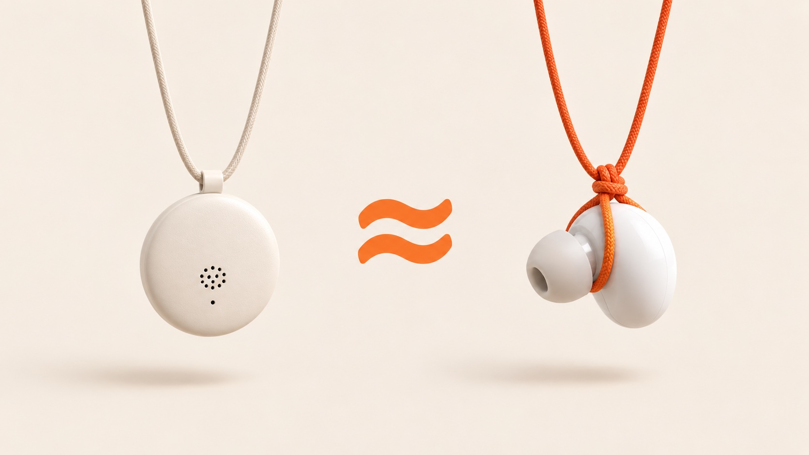
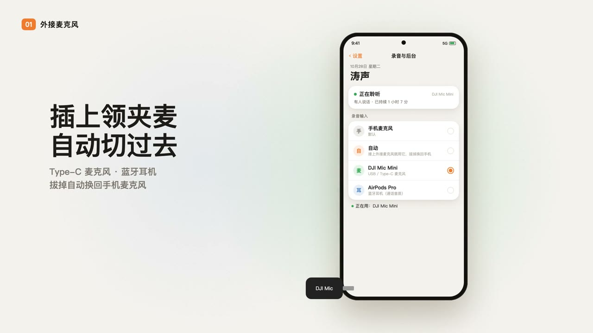
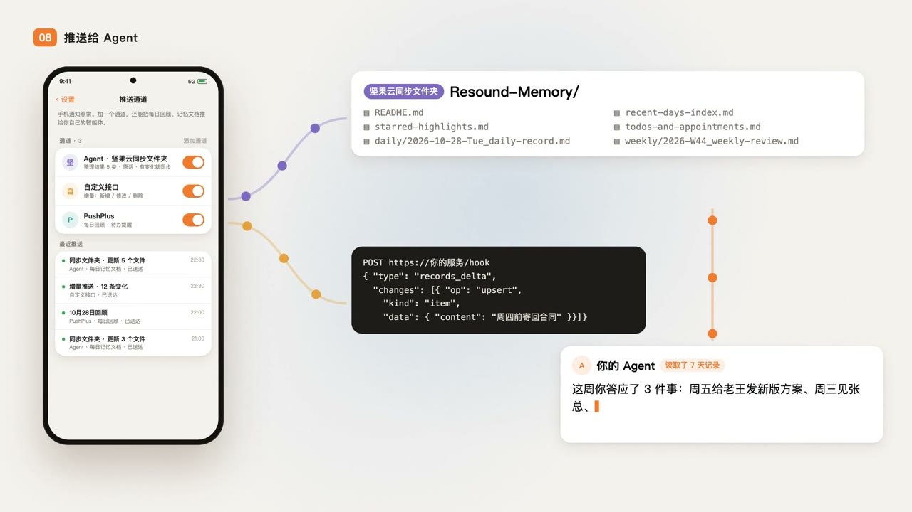
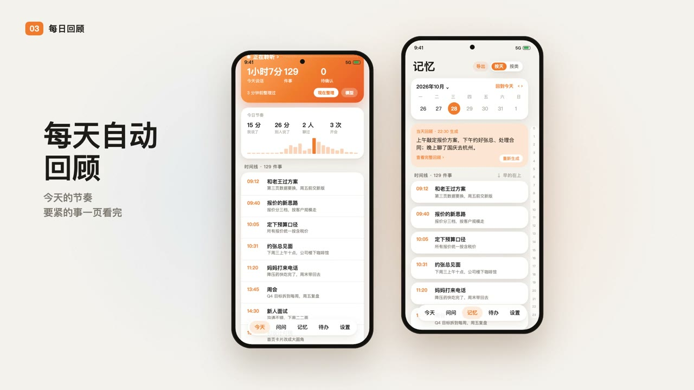
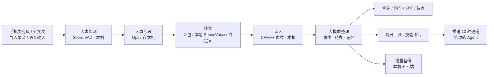

<div align="center">


# 涛声 TaoSheng

**替你听，替你记，替你想。**

一部安卓手机就够：全天收音 → 自动转写 → 认出谁在说 → AI 整理成待办、约定和记忆。<br>
不用买硬件，不用注册账号，数据只在你自己手机里。

🌐 官网：[www.taosheng.app](https://www.taosheng.app)，感谢 [@feitian124](https://github.com/feitian124) 帮忙制作，后续如考虑国际化或可能调整。

[](LICENSE)


[](https://github.com/0xCoach/TaoSheng/stargazers)

[](https://github.com/0xCoach/TaoSheng/releases/download/v0.3.0/TaoSheng-v0.3.0-arm64.apk)

简体中文 | [English](README_EN.md)

</div>

---

## 🎬 一分半看懂涛声

<div align="center">

<a href="docs/media/taosheng-film.mp4"></a>

👉 **[点这里看完整宣传片（1 分 45 秒，带配乐）](docs/media/taosheng-film.mp4)**

</div>

## 💡 为什么做涛声

每天你说了几千句话，还记得几句？

- 开会时答应的事，转头就忘；
- 朋友随口说的电话号码、约好的时间，过两天想不起来；
- 灵感说过好几次，从来没记下来。

市面上的方案要么得买录音硬件（Omi、各种 AI 吊坠、录音卡片），要么把你的声音全部传到别人的服务器上。

**涛声的思路很简单：手机本来就随身，麦克风本来就在。** 让它安安静静地在后台听，有人说话才录；隔一阵子统一转成文字，认出是谁说的，再交给大模型整理成一件件事。你需要时，打字问一句就能找回来，答案附着原话出处。

## 🧵 你和 AI 录音吊坠，只差一根绳子

<div align="center">

</div>

市面上的 AI 录音卡、录音吊坠，拆开来看就是**一个蓝牙麦克风 + 一块电池**。

涛声能把手机麦克风或者任何蓝牙收音设备当作音源。所以拿根绳子把蓝牙耳机挂在脖子上，你就有了一个 AI 录音吊坠：硬件钱省了，数据也还在你自己手机里。

<sub>蓝牙耳机走的是通话通道，音质比手机麦克风略差，安静环境够用；耳机没电或断开时，涛声会自动切回手机麦克风。</sub>

## ✨ 亮点

1. **🎙 不用买任何硬件**：手机麦克风就够；也支持领夹麦、蓝牙耳机等外接设备，插上自动切换，拔掉自动切回；还能接 Omi、安克／飞书录音豆 D3200 等专用录音设备（试用，见下方第 31 条）。
2. **📴 本地模型完全离线转写**：可选 SenseVoice 本地识别（骁龙 NPU 加速），声音不出手机、不花一分钱；也可用豆包云端或自定义转写服务（OpenAI 兼容接口，或填写完整请求地址）。
3. **⏱ 自动转写 + 自动整理，时间自己定**：转写间隔可设 15～720 分钟，转完自动整理成事件；每日回顾时间、技能运行时间都可调。
4. **🧑‍🤝‍🧑 声纹认人，分得清多个说话人**：本机声纹认出“我”和熟人，多人会议自动分段；在原话上长按选“这是谁”，指定一次就能学会这个人的声音；每个人的声纹样本都能回放、删除。
5. **✅ 自动摘出待办**：原话里答应的事、约好的时间自动变成待办；你说一句“发了”，它就知道这件事做完了。
6. **🃏 每天自动生成任务卡，技能随你定义**：会议速记、收工打卡、每周回顾、情绪日记开箱即用；写一份 JSON + 提示词就能加自己的技能。
7. **💬 AI 问问，附原话出处**：哪天说过什么、答应过谁什么，直接打字问；每个答案都能点回当时的原话。
8. **🤖 原话和整理结果自动推给你的 Agent**：每天的原话 + 整理后的文本（Markdown + JSON）自动推到 10 种通道，只推新增 / 修改 / 删除，随时给你的 Agent 调用。
9. **☁️ 每天自动备份到云端和本机**：云端可选坚果云、WebDAV（Nextcloud、群晖等）或 S3 兼容存储（阿里云、腾讯云、R2 等）；增量备份，只传变化；保留 3 / 7 / 30 天版本；可设口令加密；换手机一键恢复，设置和密钥一起回来。
10. **🧠 整理模型随便换，可完全本地运行**：内置 DeepSeek、豆包、通义、Kimi、智谱等十多家服务商，点一下切换，能查余额的显示余额并低额提醒；也支持任何 OpenAI 兼容接口（可填自定义请求头，内置 OpenCode Go）和局域网自建模型，转写 + 整理全程不出你自己的设备。
11. **🛟 主模型出问题自动换备用**：配了多个模型时，主模型断网、宕机、余额不足或密钥失效，自动按顺序换用备用模型，整理、回顾、问问都不中断（默认开启，可关）。
12. **🔒 锁屏、后台一直在听**：前台服务 + 守护，被系统杀掉自动拉起；通知栏快捷开关一键暂停。
13. **🔋 只录人声，安静不录**：本机人声检测（Silero VAD），实测自身耗电约 0.5%/小时。
14. **📺 外放时不转写**：手机在放视频、音乐时自动跳过，不把视频里的话当成你说的；别的应用要用麦克风（电话、语音消息）时自动让出。
15. **⌨️ 语音输入也记得**（可选）：在微信等应用用输入法语音输入时，记下你说的话和当时的聊天上下文，分得清哪句是你、哪句是对方；截图只在内存里识字，识完即丢。
16. **🌙 每日 / 每周自动回顾**：一句话总结、要紧的事、待办、值得留意、灵感和心力，生成后推送给你。
17. **🔁 重复的灵感自动合并**：反复提到的想法合成一条，显示“说过 N 次”，真正在意的事一眼看出来。
18. **🔤 热词纠错**：人名、公司名、行业词设一次，转写更准。
19. **📂 导入录音文件**：会议录音、语音备忘从别的应用“分享到涛声”，一样转写、认人、整理；也可以选一个文件夹（比如录音笔 App 存录音的地方），新录音自动导入，原文件不动、不重复导入。
20. **🗂 时间轴回看 + 重点标记**：拖一下回到当天任何时刻；左滑标 ★ 重点、右滑删除，可批量编辑。
21. **🔐 隐私优先**：不用注册账号、没有我们的服务器；密钥存系统安全区；原录音默认保留 3 天后自动删（可设 1～365 天，标星的可保留）；“删除最近 N 分钟”“这段别记”一键彻底删除。
22. **🔍 寻物**：“钥匙放哪了”“充电宝借给谁了”——说过的放置、带走、借出、归还自动记下，在“记忆 → 寻物”查看，也能直接问。
23. **⏰ 像闹钟一样的待办强提醒**：打字或语音添加待办；到点持续响铃、锁屏整屏提醒，音量键稍后、电源键停止。
24. **🎧 录音回放与导出**：歌词式字幕播放器（上一段 / 下一段、倍速）；多段录音合成一个 M4A，连同原话和字幕导出，先试听再保存；也可只导出摘要、待办、原话，选 TXT 或 Markdown。
25. **📝 导入录音自动出纪要**：分会议、培训、通话·访谈、普通四类，导入后自动转写、认人，按类型生成纪要。
26. **🔊 环境音识别**：听出说话之外的声音（音乐、键盘声、雨、宠物、流水、家电、脚步、闹钟、车流 9 类），写进事件和周报的“声音印象”。
27. **📋 日报周报一键复制**：全文复制、按模块多选复制或自由选字，格式和勾选状态都保留。
28. **🎙️ 专题录音与停录时段**：会议、培训、通话、口播稿一键开始，可暂停、预约，结束后合成一件事出纪要（培训不区分说话人）；忘了开始可事后补；设好时段自动停录，比如夜里不录。
29. **⬆️ App 内检查更新**：优先下载几 MB 的差异包，国内走魔搭镜像；下载完就在后台备份好，点安装直接弹出系统确认。
30. **📍 足迹**：跟着录音一起记下每天去过哪，停留的地方显示地名、自动认出“家”；一天按地点分成时间轴，每个停留点下面列出当时发生的事；可每天推送“每日足迹”。定位只存在手机里。
31. **📡 专用录音设备与开放适配（试用）**：通过设备说明卡或驱动插件接入 Omi、ADeus ESP32-C3、安克／飞书录音豆 D3200 等设备，复用涛声的转写、整理和记忆功能。D3200 试用驱动已实现实时收音、离线补传、录音控制、电量和存储查询，官方构建真机验收仍待完成；各设备能力与固件限制见[硬件接入说明](docs/硬件接入与协议适配.md)。0.3.0 已移除原内置声云适配，声云用户请暂缓升级。
32. **🧭 声音、位置、环境音联动**：事件上显示当时在哪（“📍 在公司”）；问问能按地点问——“上周在公司聊了什么”“昨天在家提到过哪些待办”；可选让整理参考当时的地点和环境音，分场景更准（默认关）。
33. **🚀 三分钟上手**：第一次打开有开箱向导——先说明再要权限、后台自动准备本机转写、一键去 DeepSeek 获取密钥（回来自动识别剪贴板）、现场说一句话看到转写和整理结果；其余设置按需提示，不打扰。
34. **📱 桌面小组件「涛声快捷」**：在手机桌面的“小组件 / 添加小部件”里找到涛声，即可查看聆听和专题状态，一点添加待办、开始专题、暂停或恢复；专题进行中，“开始专题”会变成“记一下”，随手标记重点。
35. **🎤 随口加待办，不用先找页面**：从通知栏、长按桌面图标或桌面小组件点“加待办”，直接打开语音面板；说完生成待办卡，确认后收起。
36. **🎙️ 专题模式，一场对话整理成一件事**：会议、培训、通话·访谈、口播稿、普通五种类型；支持定时、预约、暂停继续和事后补选时段，结束后按类型生成纪要。0.3.0 重做专题面板和记录列表，支持搜索、筛选、删除；“记一下”标出的重点可撤销、删除，点时间即可回到原话。
37. **📝 长会议分段整理，中断后继续**：显示整理进度，继续时复用已完成的分段结果；失败专题可用已有原话重试，无需重新转写；重新生成期间保留原纪要，成功后再替换。
38. **🔎 设置能搜索，问题有入口**：在设置里搜“耗电”“不录”等常用说法，点结果即可定位并高亮对应选项；设置首页的体检提示集中展示需要处理的问题。
39. **🌗 首页与夜间模式焕新**：聆听、暂停、专题操作更集中，进行中的专题显示计时和重点操作；夜间采用纯黑背景、分层文字和橙色点缀，并改善大字体显示。

<table>
<tr>
<td width="50%"></td>
<td width="50%"></td>
</tr>
<tr>
<td><b>🎙 全天在听，锁屏也不停</b><br>后台常驻 + 守护进程，被系统杀掉会自动拉起；只在有人说话时录，安静时不录，省电。</td>
<td><b>🧑‍🤝‍🧑 认得出谁在说</b><br>本机声纹认出“我”，也认得熟人；长按原话选“这是谁”，指定一次就记住这个人的声音。</td>
</tr>
<tr>
<td></td>
<td></td>
</tr>
<tr>
<td><b>🧠 AI 整理成一件件事</b><br>说过的话自动变成事件、待办、约定、决定和灵感，按时间排好，关键信息一眼看到。</td>
<td><b>💬 直接问，答案附原话</b><br>“上周我答应老王什么了？”——大模型带查询工具去翻你的记忆，每个结论都能点回原话。</td>
</tr>
<tr>
<td></td>
<td></td>
</tr>
<tr>
<td><b>🃏 技能卡片，按你的方式整理</b><br>会议速记、收工打卡、每周回顾、情绪日记……每个技能就是一份提示词，可以自己写。</td>
<td><b>🤖 推给你的 Agent</b><br>每天的记忆打包成 Markdown + JSON 推出去，只推新增 / 修改 / 删除，方便你自己的 AI 再加工。</td>
</tr>
<tr>
<td></td>
<td></td>
</tr>
<tr>
<td><b>🌙 每天自动回顾</b><br>晚上 22:00 生成当天回顾：一句话总结、要紧的事、待办、值得留意、灵感和心力；周日再出一份周回顾。</td>
<td><b>☁️ 每天自动备份</b><br>增量备份到本机 + 坚果云 / WebDAV / S3，保留 3 / 7 / 30 天版本；换手机一键全部恢复，连设置和密钥都在。</td>
</tr>
</table>

### 支持的推送通道

PushPlus · 企业微信机器人 · Server 酱 · 飞书 · 钉钉 · Telegram · 邮件 · Notion · 同步文件夹（坚果云 / WebDAV / S3，可接 Obsidian） · 自定义 Webhook

可推：每日回顾、待办提醒、新整理的事、技能卡片、每日记忆文档（含原话）；格式可选纯文本 / Markdown / JSON。

## 📡 硬件接入与协议适配

手机之外，也可以把录音豆、录音卡或开源吊坠作为涛声的声音来源，继续使用同一套转写、整理、待办与记忆功能。

- **已有设备**：普通蓝牙耳机、有线或 USB 麦克风走系统音频输入；专用设备按协议通过说明卡或驱动插件接入。当前提供 Omi、ADeus ESP32-C3 说明卡，以及安克／飞书录音豆 D3200 试用驱动。各设备的实时收音、离线补传和控制能力不同。
- **录音豆 D3200**：驱动包含实时收音、离线补传、录音控制及录音豆 / 充电盒电量、存储查询。原贡献者验证包已有部分实测记录，迁移后的官方构建仍待真机验收，其他固件也需单独验证。
- **统一的硬件适配规范**：涛声提供设备说明卡和驱动插件的适配规范。厂商与开发者按规范接入后，可复用现有的设备管理、转写、整理和记忆能力，减少重复开发。设备专属逻辑集中在对应适配模块中，减少对核心代码的改动，方便后续维护和扩展。欢迎提供协议资料、SDK、设备及固件信息、测试样机参与适配。

[设备能力与接入指南](docs/硬件接入与协议适配.md) · [硬件适配规范](docs/taoecho/README.md) · [插件提交与真机验收要求](docs/taoecho/插件提交清单.md) · [在 GitHub 发起接入讨论](https://github.com/0xCoach/TaoSheng/issues/new)

## 🚀 快速开始

### 准备

| 需要 | 说明 |
| --- | --- |
| 安卓手机 | Android 10 及以上，arm64 架构。开发和实测机型：小米 14 Pro（澎湃 OS 3） |
| 转写服务 | 三选一：[豆包语音](https://www.volcengine.com/product/voice-tech) API Key；直接用**本地转写**（首次使用时在手机上下载模型）；或自定义转写服务 |
| 大模型 | 任意 OpenAI 兼容接口的 API Key，默认 [DeepSeek](https://platform.deepseek.com/) |
| 可选 | 坚果云、WebDAV 或 S3 存储（备份）、任一推送通道 |

### 下载安装（推荐）

| 版本 | 发布日期 | 下载 | 说明 |
| --- | --- | --- | --- |
| **v0.3.0**（最新） | 2026-11-13 | [GitHub 安装包](https://github.com/0xCoach/TaoSheng/releases/download/v0.3.0/TaoSheng-v0.3.0-arm64.apk) · [魔搭国内下载](https://modelscope.cn/models/OpenRecode/TaoSheng-releases/resolve/master/TaoSheng-v0.3.0-arm64.apk) | 首页与夜间模式焕新；语音待办与桌面小组件；专题记录管理、长会议分段续做；设置搜索与体检；减少后台开销。升级前备份，旧声云适配已移除。[详细更新日志](CHANGELOG.md#030--2026-11-13) |
| **v0.2.22** | 2026-11-11 | [GitHub 安装包](https://github.com/0xCoach/TaoSheng/releases/download/v0.2.22/TaoSheng-v0.2.22-arm64.apk) · [魔搭国内下载](https://modelscope.cn/models/OpenRecode/TaoSheng-releases/resolve/master/TaoSheng-v0.2.22-arm64.apk) | 新增专题录音（会议、培训、通话、口播稿，结束后合成一件事出纪要，可暂停、预约、事后补）；问问换模型也能用（Gemini 兼容、程序先查兜底）；整理被拒收不再卡住。数据库升级，不能直接降级。[详细更新日志](CHANGELOG.md#0222--2026-11-11) |
| **v0.2.21** | 2026-11-10 | [GitHub 安装包](https://github.com/0xCoach/TaoSheng/releases/download/v0.2.21/TaoSheng-v0.2.21-arm64.apk) · [魔搭国内下载](https://modelscope.cn/models/OpenRecode/TaoSheng-releases/resolve/master/TaoSheng-v0.2.21-arm64.apk) | 新增足迹，并和声音、环境音联动（事件显示当时在哪、问问按地点问）；专用录音设备接入（试用）；开箱向导三分钟上手；锁屏本地转写更省电；更新前备份提前；问题记录含大模型诊断。数据库升级，不能直接降级。[详细更新日志](CHANGELOG.md#0221--2026-11-10) |
| **v0.2.20** | 2026-11-10 | [GitHub 安装包](https://github.com/0xCoach/TaoSheng/releases/download/v0.2.20/TaoSheng-v0.2.20-arm64.apk) · [魔搭国内下载](https://modelscope.cn/models/OpenRecode/TaoSheng-releases/resolve/master/TaoSheng-v0.2.20-arm64.apk) | 修复麦克风“假运行”丢录音；蓝牙录音让出话筒给输入法；备份可选 WebDAV、S3；导出可只要文字、可选 Markdown；文件夹自动导入；推送换行；自定义请求头与 OpenCode Go。[详细更新日志](CHANGELOG.md#0220--2026-11-10) |
| **v0.2.19** | 2026-11-08 | [GitHub 安装包](https://github.com/0xCoach/TaoSheng/releases/download/v0.2.19/TaoSheng-v0.2.19-arm64.apk) · [魔搭国内下载](https://modelscope.cn/models/OpenRecode/TaoSheng-releases/resolve/master/TaoSheng-v0.2.19-arm64.apk) | 整理不再切碎；新增“整理前先思考”开关；多选合并几件事；重新整理显示分批进度，修复整天重新整理闪退。[详细更新日志](CHANGELOG.md#0219--2026-11-08) |
| **v0.2.18** | 2026-11-08 | [GitHub 安装包](https://github.com/0xCoach/TaoSheng/releases/download/v0.2.18/TaoSheng-v0.2.18-arm64.apk) · [魔搭国内下载](https://modelscope.cn/models/OpenRecode/TaoSheng-releases/resolve/master/TaoSheng-v0.2.18-arm64.apk) | 声纹样本管理：每个人的样本能回放、删除，样本声音可一键清除；自定义转写可填写完整请求地址。[详细更新日志](CHANGELOG.md#0218--2026-11-08) |
| **v0.2.17** | 2026-11-07 | [GitHub 安装包](https://github.com/0xCoach/TaoSheng/releases/download/v0.2.17/TaoSheng-v0.2.17-arm64.apk) · [魔搭国内下载](https://modelscope.cn/models/OpenRecode/TaoSheng-releases/resolve/master/TaoSheng-v0.2.17-arm64.apk) | 主模型出问题自动换备用模型；修复内容多的日子生成回顾失败（按模型容量完整发送）；修复加密备份恢复没有口令框；兼容鸿蒙等系统的本机备份文件夹授权。[详细更新日志](CHANGELOG.md#0217--2026-11-07) |
| **v0.2.16** | 2026-11-03 | [GitHub 安装包](https://github.com/0xCoach/TaoSheng/releases/download/v0.2.16/TaoSheng-v0.2.16-arm64.apk) · [魔搭国内下载](https://modelscope.cn/models/OpenRecode/TaoSheng-releases/resolve/master/TaoSheng-v0.2.16-arm64.apk) | 修复七天统计长事务导致的删除延迟；轻量快照与媒体匹配优化；删除阶段提示及防重复操作。手机性能测试与实际删除复测通过。[详细更新日志](CHANGELOG.md#0216--2026-11-03) |
| **v0.2.15** | 2026-11-02 | [GitHub 安装包](https://github.com/0xCoach/TaoSheng/releases/download/v0.2.15/TaoSheng-v0.2.15-arm64.apk) · [魔搭国内下载](https://modelscope.cn/models/OpenRecode/TaoSheng-releases/resolve/master/TaoSheng-v0.2.15-arm64.apk) | 寻物与整理共用请求；日报周报改版；全文/模块/自由选字复制；问问追问出处修复；轻声收音与播放修复；本地识别语言选择；删除、备份稳定性改进。[详细更新日志](CHANGELOG.md#0215--2026-11-02) |
| **v0.2.14** | 2026-10-30 | [TaoSheng-v0.2.14-arm64.apk](https://github.com/0xCoach/TaoSheng/releases/download/v0.2.14/TaoSheng-v0.2.14-arm64.apk)（约 98 MB） | 转写提速（豆包更快、流量大降）；课堂模式与区分说话人开关；导入录音分会议/培训/通话·访谈/普通并自动出纪要；多服务商一键切换与余额提醒；待办能看原话、听原声；环境音更易识别；问问正确显示格式等 |
| **v0.2.13** | 2026-10-29 | [TaoSheng-v0.2.13-arm64.apk](https://github.com/0xCoach/TaoSheng/releases/download/v0.2.13/TaoSheng-v0.2.13-arm64.apk)（约 97 MB） | 录音导出（多段合成 M4A + 原话 + 字幕，先试听再保存，后台合成）；全新播放器（歌词式字幕、上一段/下一段、倍速）；今日节奏重做；时间线筛选与多选批量操作；本机转写认热词；停录时段；局域网自建模型；修复推送误报等 |
| **v0.2.12** | 2026-10-28 | [TaoSheng-v0.2.12-arm64.apk](https://github.com/0xCoach/TaoSheng/releases/download/v0.2.12/TaoSheng-v0.2.12-arm64.apk)（约 96 MB） | 手动/语音添加待办；像闹钟一样的强提醒（持续响铃、锁屏整屏提醒、音量键稍后/电源键停止，附设置检查清单）；整理可按时间点；模型检测逐项显示原因（如“模型不支持工具调用”） |
| **v0.2.11** | 2026-10-28 | [TaoSheng-v0.2.11-arm64.apk](https://github.com/0xCoach/TaoSheng/releases/download/v0.2.11/TaoSheng-v0.2.11-arm64.apk)（约 91 MB） | App 内检查更新，优先下载几 MB 的差异包，装前自动备份；语音输入每段都带上下文（快速连发、小红书等），与录音不再重复；设置新增“关于涛声” |
| **v0.2.9** | 2026-10-27 | [TaoSheng-v0.2.9-arm64.apk](https://github.com/0xCoach/TaoSheng/releases/download/v0.2.9/TaoSheng-v0.2.9-arm64.apk)（约 91 MB） | 后台录音 CPU 占用约降三分之二；本地转写可随说随转，转写与整理分开设置；只在系统静音时才让出麦克风并提示可能占用的应用；技能卡推送带完整内容；首次使用上手清单与一键准备本地模型；适配大字体、小屏与折叠屏；去掉 ML Kit 使用统计上报 |
| **v0.2.8** | 2026-10-27 | [TaoSheng-v0.2.8-arm64.apk](https://github.com/0xCoach/TaoSheng/releases/download/v0.2.8/TaoSheng-v0.2.8-arm64.apk)（约 91 MB） | 本地模型优先从魔搭国内源下载，支持断点续传、备用源切换及完整性校验；已有模型无需重下 |
| **v0.2.7** | 2026-10-27 | [TaoSheng-v0.2.7-arm64.apk](https://github.com/0xCoach/TaoSheng/releases/download/v0.2.7/TaoSheng-v0.2.7-arm64.apk)（约 91 MB） | 升级 ONNX Runtime 1.25.1，修复部分 Oryon 机型开始聆听时的 SIGILL 闪退 |
| **v0.2.6** | 2026-10-26 | [TaoSheng-v0.2.6-arm64.apk](https://github.com/0xCoach/TaoSheng/releases/download/v0.2.6/TaoSheng-v0.2.6-arm64.apk)（约 88 MB） | 首页逐步显示整理进度；长对话也能及时整理；整理时机可调；声纹标注不再全量重配；NPU 只检查一次；模型下载可重试 |
| **v0.2.1** | 2026-10-26 | [TaoSheng-v0.2.1-arm64.apk](https://github.com/0xCoach/TaoSheng/releases/download/v0.2.1/TaoSheng-v0.2.1-arm64.apk)（约 88 MB） | 修复外放误判；新增“外放声音时不转写”开关 |
| **v0.2.0** | 2026-10-26 | [TaoSheng-v0.2.0-arm64.apk](https://github.com/0xCoach/TaoSheng/releases/download/v0.2.0/TaoSheng-v0.2.0-arm64.apk)（约 88 MB） | 首个公开版（早期验证版） |

- 只支持 64 位安卓手机（arm64-v8a，近几年的手机基本都是），Android 10 及以上。
- 手机上直接打开下载的 apk 安装；提示“未知来源”时按提示允许即可。
- 历史版本和更新说明见 [Releases](https://github.com/0xCoach/TaoSheng/releases)。
- 最新版文件校验（SHA-256）见 [正式版附件 SHA256SUMS](https://github.com/0xCoach/TaoSheng/releases/download/v0.3.0/SHA256SUMS)。
- 正式签名证书指纹（SHA-256）：`7c11f9afc2cdfc8ba334a7bba69b005aecc609d81fcd12d01bcec2752f496b07`。只认这个签名的安装包，别处下载的改装版可能被动过手脚。

### 从源码编译

提交前请完成本地检查；推送到 main 或提交 PR 后，GitHub Actions 会自动检查共用边界、安卓编译与单测，并在共用代码或构建配置变化时检查 iOS 编译。

```bash
git clone https://github.com/0xCoach/TaoSheng.git
cd TaoSheng

# 需要 JDK 21 和 Android SDK Platform 36；JAVA_HOME 指向本机 JDK 21
echo "sdk.dir=/path/to/android-sdk" > local.properties

./gradlew assembleDebug
adb install -r app/build/outputs/apk/debug/app-debug.apk
```

Windows PowerShell：

```powershell
$env:JAVA_HOME = 'C:\Users\你的用户名\.jdks\你的JDK21目录'
.\gradlew.bat assembleDebug
```

用 Android Studio 打开项目时，将 Gradle JDK 设为 **JDK 21**，并安装 Android SDK Platform 36。SDK 路径保存在被 Git 忽略的 `local.properties`；不要把本机 JDK 路径写进共享的 `gradle.properties`。

> 也可以直接用 Android Studio 打开项目，点运行。
>
> **部分 Oryon 机型的闪退修复**：从 v0.2.7 起升级官方 `onnxruntime-android:1.25.1`，修复旧版在部分仅支持 SME1 的设备上错误派发 SME2 算子导致的 `SIGILL`。不再使用二进制补丁。基于相同依赖的测试版已获 OPPO Find N6 和小米 pandora（25098PN5AC）用户复测通过；其他机型仍欢迎反馈。

### 第一次使用（约 3 分钟）

第一次打开涛声会有开箱向导，跟着点就行：

1. **打开必要权限**：麦克风、通知、电池白名单，每项都先说明用途再弹系统确认；同时在后台自动下载本机转写模型（约 170～330 MB，用流量时会提醒）。
2. **配置整理模型**：点“去 DeepSeek 获取密钥”，在网页里创建密钥并复制，回到涛声会自动识别并测试；也可以“以后再说”，或之后在 设置 →「整理模型」换成别家 / 自定义接口。
3. **说句话试试**：模型装好后说一句话，当场看到转写和整理出的事件、待办。
4. **其他设置（可选）**：向导最后会问要不要现在设置后台保活、备份、推送、足迹；小米 / 澎湃 OS 建议做一下后台保活（自启动、电池无限制）。
5. （可选）**录入声纹**：设置 →「声纹与人物」→ 我，照着屏幕朗读三段短文，涛声就能认出哪句是你说的。

换手机的老用户：在向导第一页点“换手机了？从备份恢复”。

### 日常怎么用

| 页面 | 做什么 |
| --- | --- |
| **今天** | 收音状态、今日节奏、待确认的待办、按时间排的事；拖时间轴回看 |
| **问问** | 打字提问，“这周我答应了哪些事？”“老王的电话是多少？”，答案附原话 |
| **记忆** | 按天的日记、关键信息、重点 ★、灵感，以及技能卡片 |
| **待办** | 待确认 / 进行中 / 已完成；左滑标重点，右滑删除 |
| **设置** | 录音与后台（含专用录音设备、文件夹自动导入）、原话与转写、整理模型、声纹与人物、整理技能、整理指令、每日回顾、推送通道、热词识别、环境音识别、足迹、数据备份、版本更新 |

### 自己写一个技能

技能放在 `app/src/main/assets/skills/<名字>/`，由两个文件组成：

- `skill.json`：名字、什么时候跑（每天定点 / 每次整理后）、取哪段时间谁说的话、卡片有哪些栏目（文字、要点、清单、标签、原话……）
- `prompt.md`：交给大模型的提示词

参考自带的 [`meeting`](app/src/main/assets/skills/meeting)（会议速记）照着改即可。

## 🏗 怎么做到的



| 部分 | 技术 |
| --- | --- |
| 界面 | Kotlin · Jetpack Compose · 浅色暖橙主题 + 夜间模式 |
| 存储 | Room（SQLite + FTS4 全文检索）· 本机向量检索 |
| 后台 | 前台服务 + WorkManager + 守护 · 无障碍服务（语音输入，可选） |
| 本机模型 | Silero VAD · CAM++ 声纹 · SenseVoice（sherpa-onnx + 高通 QNN NPU）· pyannote 分段 |
| 云端 | 豆包语音流式识别 2.0 · 自定义转写服务 · DeepSeek 等十多家服务商 / 任意 OpenAI 兼容接口 |

```
app/src/main/java/app/resound/
├── capture/     收音服务、人声切段、守护、语音输入
├── audio/       音频来源（手机麦 / 外接麦）、编码
├── transcribe/  云端 / 本地 / 自定义转写、热词
├── voiceprint/  声纹提取、认人与样本管理
├── digest/      大模型整理成事件和记忆
├── ask/         “问问”：大模型 + 查询工具 + 原话出处
├── review/      每日 / 每周回顾
├── skills/      技能卡片框架
├── push/        十种推送通道
├── backup/      增量备份与恢复（本机 + WebDAV / S3）
├── privacy/     删除与隐私开关
└── ui/          全部界面
```

## 🤖 一个 AI 写出来的 App

涛声的代码几乎全部由 AI 完成：**Claude** 负责架构、接口约定和全部界面，**Codex** 负责录音、转写、数据库、推送、备份等底层。人只做一件事——提需求、在手机上实测、说哪里不对。

近百张任务卡和每一张的交付说明都公开在 [`docs/任务卡/`](docs/任务卡)，包括踩过的坑（比如安卓正则比电脑严格导致的启动崩溃、坚果云请求太多会 503）。想看 AI 协作开发是怎么一步步推进的，可以从那里读起。

## 🗺 路线图

已完成：

- [x] 全天收音、人声检测、后台保活
- [x] 云端 / 本地转写、热词
- [x] 本机声纹认人、多人分段
- [x] AI 整理、问问、每日 / 每周回顾、技能卡片
- [x] 十种推送通道、增量备份与恢复（坚果云 / WebDAV / S3）
- [x] 语音输入记录（含微信截屏识字）
- [x] 足迹，以及声音、位置、环境音联动
- [x] 专用录音设备接入（说明卡 + 文件插件，试用）
- [x] 开箱向导，三分钟上手

下一步：

- [ ] 持续优化录音、转写和 AI 整理体验
- [ ] 上线官网，完善新手引导和使用文档
- [ ] 探索开箱即用、按量付费的 AI 服务
- [ ] 逐步适配 ESP32 等录音设备，探索开放接入协议
- [ ] 推进 Google Play 上架，探索 iOS 版本

*具体进度和支持范围以实际开发和测试结果为准。*

## ⚠️ 使用须知

- 涛声是**个人记忆工具**。录音和保存他人对话在很多国家和地区受法律约束，请遵守当地法律，并在需要时告知身边的人。
- 涛声刻意保留了常驻通知和系统麦克风指示灯，**不会也不应被改造成隐蔽录音工具**。
- 当前是早期验证版，主要在小米 14 Pro 上实测；其他品牌的后台保活策略差异很大，欢迎提 Issue 反馈你的机型表现。
- 云端转写和大模型按服务商价格计费，费用由你自己的账号承担；用本地转写可以省掉转写费用。

## 🙏 致谢

- [@feitian124](https://github.com/feitian124)：感谢帮忙制作涛声官网。
- [@ethansunqing](https://github.com/ethansunqing)：在 [PR #1](https://github.com/0xCoach/TaoSheng/pull/1) 中报告并定位 OPPO Find N6 的 SIGILL 闪退，提供初始二进制补丁方案，并完成 ONNX Runtime 1.25.1 升级后的真机复测。
- [@brookDeng](https://github.com/brookDeng)：补充小米 pandora（25098PN5AC）的独立故障分析，以及升级测试版后的覆盖安装、数据保留和前后台聆听复测。
- [@aadnapp](https://github.com/aadnapp)：在 [PR #7](https://github.com/0xCoach/TaoSheng/pull/7) 中提供 Android 9 兼容适配方案、手动让出麦克风的实现及真机测试反馈，为项目评估旧系统支持提供了参考。
- [@JunWeiUp](https://github.com/JunWeiUp)：在 [PR #9](https://github.com/0xCoach/TaoSheng/pull/9) 中贡献本机声纹样本管理（样本回放、删除、样本声音清理与占用统计、备份排除），此前在 [PR #8](https://github.com/0xCoach/TaoSheng/pull/8) 提出了自建异步语音服务的对接方案。
- [@SoukNow](https://github.com/SoukNow)：在 [PR #10](https://github.com/0xCoach/TaoSheng/pull/10) 中贡献自定义转写的完整请求地址写法。
- [@JunWeiUp](https://github.com/JunWeiUp)：在 [PR #19](https://github.com/0xCoach/TaoSheng/pull/19) 中贡献**足迹**：全天定位记录、地名与“家”的识别、一天时间轴、手动改地点和每日足迹推送，并在真机上长期使用验证。
- [@sheacoding](https://github.com/sheacoding)：在 [PR #14](https://github.com/0xCoach/TaoSheng/pull/14)～[#16](https://github.com/0xCoach/TaoSheng/pull/16) 中完整探索了声云录音卡的接入（实时收音、蓝牙文件导入、Wi-Fi 快传），促成了涛声通用的专用录音设备接入结构。
- [@a327173196](https://github.com/a327173196)：在 [#20](https://github.com/0xCoach/TaoSheng/issues/20)、[#21](https://github.com/0xCoach/TaoSheng/issues/21)、[#25](https://github.com/0xCoach/TaoSheng/issues/25) 中细致排查鸿蒙兼容层的本机备份、后台转写问题，并提出问题记录补充大模型诊断。
- [@BulbLi](https://github.com/BulbLi)：在 [#18](https://github.com/0xCoach/TaoSheng/issues/18) 中提出接入 OpenCode Go 与自定义请求头。

- [Omi](https://github.com/BasedHardware/omi)——开源 AI 可穿戴设备，给了涛声最初的灵感
- [sherpa-onnx](https://github.com/k2-fsa/sherpa-onnx)（Apache-2.0）——本地转写、分段与声纹的运行框架
- [Silero VAD](https://github.com/snakers4/silero-vad)（MIT）——人声检测
- [CAM++ / 3D-Speaker](https://github.com/modelscope/3D-Speaker)（Apache-2.0）——声纹模型
- [SenseVoice](https://github.com/FunAudioLLM/SenseVoice)——本地语音识别模型（运行时下载，遵循其原始许可）
- [pyannote segmentation](https://github.com/pyannote/pyannote-audio)（MIT）——多人分段

第三方组件的详细来源与许可见 [`docs/third-party/`](docs/third-party)。其中高通 QNN 运行库取自 sherpa-onnx 官方发布包，遵循高通原始许可。

## 📄 许可

[MIT](LICENSE) © 2026 0xCoach

<div align="center">

如果涛声对你有用，点个 ⭐ 让更多人看到。

</div>

## ⭐ Star 历史

<div align="center">

<a href="https://star-history.com/#0xCoach/TaoSheng&amp;Date">
<picture>
  <source media="(prefers-color-scheme: dark)" srcset="https://api.star-history.com/svg?repos=0xCoach/TaoSheng&amp;type=Date&amp;theme=dark">
  <source media="(prefers-color-scheme: light)" srcset="https://api.star-history.com/svg?repos=0xCoach/TaoSheng&amp;type=Date">
  
</picture>
</a>

</div>
