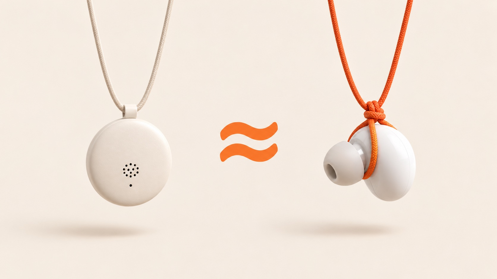
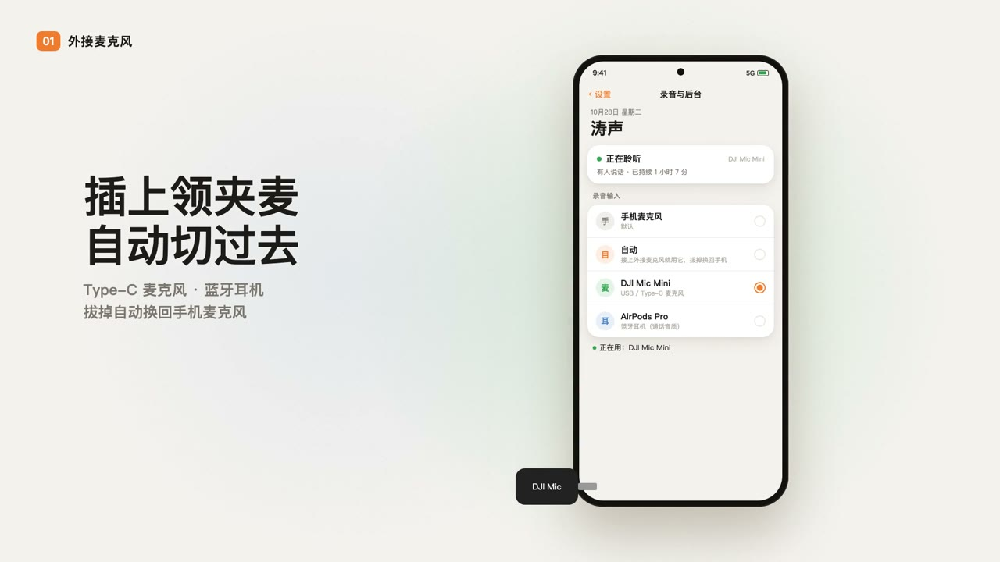
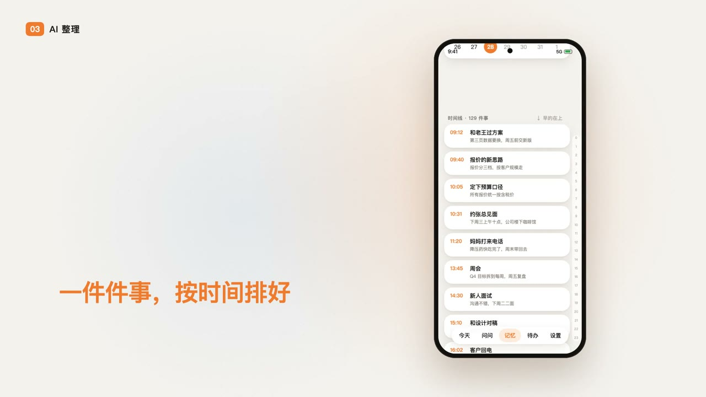
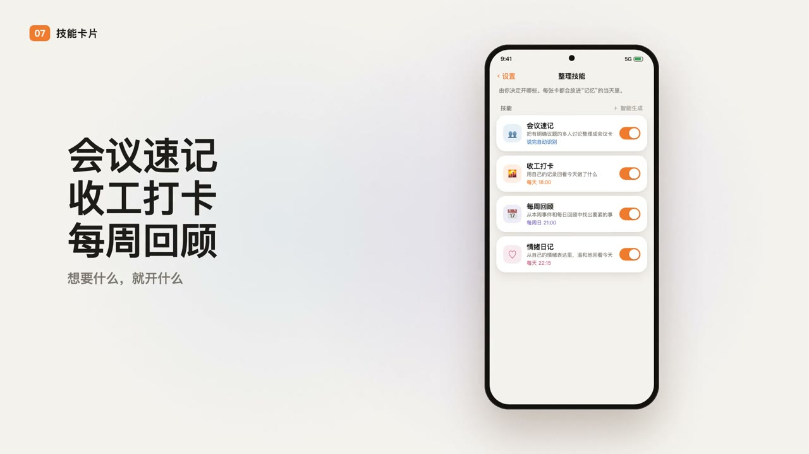
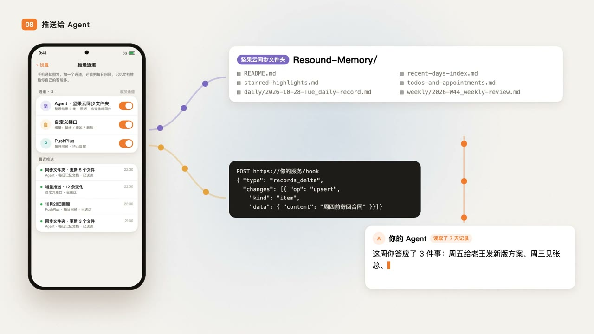
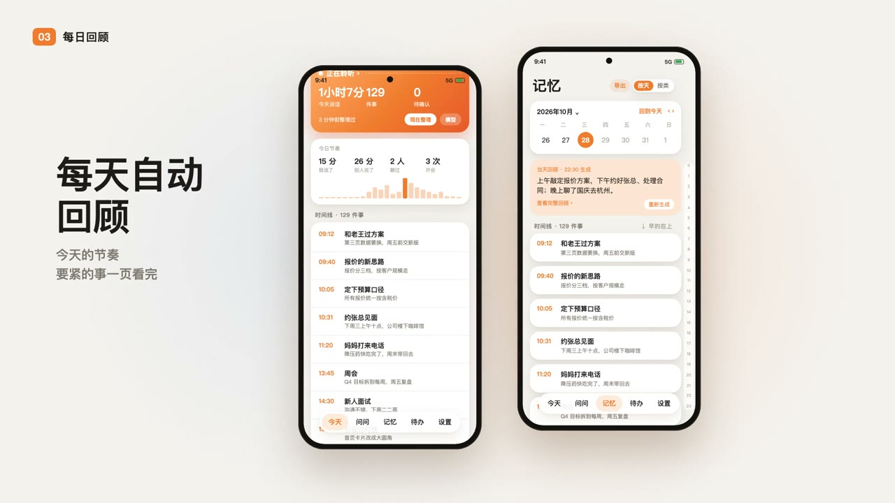
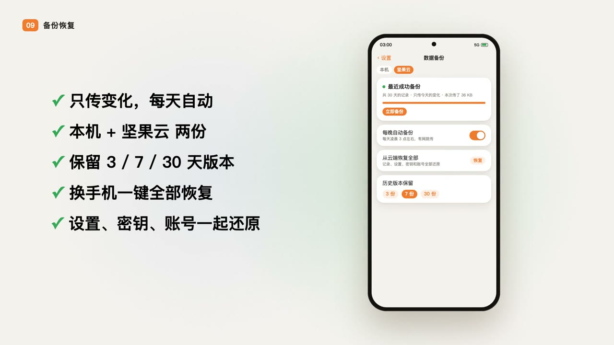
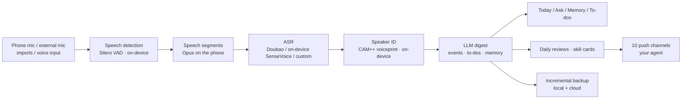

<div align="center">


# TaoSheng 涛声

**It listens, remembers, and thinks — for you.**

Just an Android phone: all-day listening → automatic transcription → knows who's speaking → AI turns it into todos, promises and memories.<br>
No hardware to buy. No account. Your data stays on your phone.

🌐 Website: [www.taosheng.app](https://www.taosheng.app). Thanks to [@feitian124](https://github.com/feitian124) for helping build it; the website may change as we consider internationalization.

[](LICENSE.md)


[](https://github.com/0xCoach/TaoSheng/stargazers)

[](https://github.com/0xCoach/TaoSheng/releases/download/v0.5.5/TaoSheng-v0.5.5-arm64.apk)

[简体中文](README.md) | English

</div>

---

## 🎬 Watch the 1:45 film

<div align="center">

<a href="docs/media/taosheng-film.mp4"></a>

👉 **[Watch the full film (1:45, with soundtrack)](docs/media/taosheng-film.mp4)**

</div>

> The app UI is currently in Chinese only.

## 💡 Why TaoSheng

You say thousands of sentences a day. How many do you remember?

- Things you promised in a meeting, forgotten the moment you walk out;
- A phone number or a time a friend mentioned in passing, gone two days later;
- An idea you've said out loud several times but never written down.

Existing options either need a dedicated recorder (Omi, AI pendants, recording cards) or send all your audio to someone else's server.

**TaoSheng's idea is simple: you already carry a phone, and it already has a microphone.** It quietly listens in the background and records only when someone is speaking; every so often it transcribes, recognizes who said what, and lets an LLM organize it into events. When you need something, just type a question — every answer links back to the original words.

## 🧵 You're one string away from an AI pendant

<div align="center">

</div>

Take apart an AI recording card or pendant and you'll find **a Bluetooth mic plus a battery**.

TaoSheng can use the phone mic or any Bluetooth audio input as its source. Hang your Bluetooth earbuds around your neck on a string and you've got an AI pendant: no hardware to buy, and your data stays on your own phone.

<sub>Bluetooth earbuds record through the call channel, so quality is a bit lower than the phone mic — fine in quiet rooms. If the earbuds die or disconnect, TaoSheng switches back to the phone mic automatically.</sub>

---

## ✨ Highlights

### 🎙️ Round-the-clock capture (from daytime talk to sleep talk)

**📱 No hardware needed, every source and every call**

- The phone mic works out of the box; lavalier mics, Bluetooth earbuds and DJI Mic switch automatically when plugged in or out
- A Bluetooth mic yields to video playback so sound plays normally, and recording continues on the phone mic
- Dedicated recorders such as Omi, ADeus ESP32-C3 and the Anker / Feishu D3200 are supported (beta)
- Your phone's own call recordings are imported automatically with the other party and time; contacts are never read and numbers are never sent to any model

**🗣️ Offline transcription + on-device voiceprints**

- Fully offline SenseVoice on the phone, accelerated by the Snapdragon NPU
- Or Doubao cloud (pay-as-you-go API, or the dedicated key of a Volcengine Ark Agent Plan), Alibaba Bailian Qwen (with speaker separation) and any custom OpenAI-compatible ASR, with per-sentence times and speakers and tap-to-replay
- Long-press a misheard sentence to fix it in place; it's marked "corrected" and can be re-digested in one tap
- On-device voiceprints tell you apart from people you know — long-press a line once and pick "who is this?"
- Hotword correction and voiceprint sample management

**🌙 Nights: sleep, snoring and sleep talk**

- Leave the phone by the bed: it starts once you fall asleep and ends when you unlock, unplug or dismiss the alarm; naps, night shifts and daytime sleep too
- A whole-night sound map marks snoring, coughs and sleep talk; sleep talk becomes text, tap to replay, swipe to correct so it keeps learning
- Pinch or double-tap to zoom down to 5-second bars, long-press to read the exact time and loudness, jump to the night's loudest moment in one tap
- Snore pauses can be replayed and confirmed by ear
- Tag nights to compare what helps; a chart-based one-page PDF for your doctor over 7 / 30 / 90 days (for reference only, not a medical test)

**🔊 Ambient sound: what was going on around you**

- Recognizes 9 kinds of surroundings on the phone — music, keyboard, rain, pets, running water, appliances, footsteps, alarm clocks and nearby traffic; audio never leaves the phone
- Also notes special sounds — a baby crying, knocking, a dog barking, sirens — recorded only, never alerting you
- Segments of pure music or pure background noise are skipped instead of transcribed, saving time and money; likely TV or film playback is flagged separately
- Event cards and reviews show the surroundings at the time; the digest can optionally take place and ambient sound into account (off by default)

**🧭 Footprint + screen time + playback, stitched into a "day thread"**

- Records where you went each day (footprint) and which apps you used (screen-time band)
- Shows and videos the phone plays aloud are tagged "playback", never mistaken for your own words
- Every early morning, where you went, who you talked to, what you used and how you slept are finalized into a "day thread" at the top of your pushed document, robust to time-zone changes

### 🧠 AI digest, to-dos and instant recall

**✅ To-dos extracted automatically + calendar + alarm-style reminders**

- Promises in your words become to-dos, and are marked done when you later say "sent it"
- Add a to-do by voice from the notification, a long-press on the app icon or the widget
- Week / month calendar view; move all overdue items to today in one tap
- Add to the phone calendar in one tap; full-screen, alarm-style reminders on the lock screen

**🔍 Ask + global search, every answer cited**

- Ask "what did I promise Wang at the office last week?", "who borrowed the power bank?", "what was I scrolling this afternoon?"
- Filter by place and time; tap any answer back to the original lines
- One search box across lines, events, to-dos, found things, topics and reviews on every date
- Repeated ideas are merged with a count

**📌 Topic recording, marks and automatic reviews**

- Start a meeting, training, call·interview or voice-script session in one tap; schedule, pause or pick it afterwards
- Digest as you go: meetings are processed in 10-minute blocks while still running, so notes arrive soon after the end; only a changed block is redone, and notes come out even when attendees aren't recognized
- Tap "📍 Mark" while recording or playing back: the moments around it are written up in more detail and the key audio is kept
- Daily / weekly reviews and skill cards are generated automatically

### 🔒 Privacy first, steady and frugal in the background

**🛡️ Your data stays 100% yours**

- No account, no server of ours; keys live in the system Keystore
- Location, screen time, sleep audio and call numbers stay on the phone
- Original audio is deleted after 3 days by default (1–365 days, starred items kept); sleep clips after 7 days unconfirmed or 90 days confirmed
- "Forget the last N minutes" and "don't keep this" erase everything, screen time included

**🔋 Records only speech, ~0.5% battery per hour in testing**

- On-device Silero VAD; silence is never recorded
- A foreground service with watchdog checks and digests on your schedule (every 15–720 minutes)
- Keep-alive guidance for Huawei, Honor and HarmonyOS (including the Zhuoyitong layer)
- Interrupted on-device transcription resumes where it stopped instead of starting over

**🔀 Bring your own model + automatic failover**

- A dozen built-in providers (DeepSeek, Doubao, Qwen, Kimi, GLM…) with balance checks and low-balance alerts
- Custom request headers (OpenCode Go built in) and LAN self-hosted models for a fully local pipeline
- With several models configured, a dead, offline or out-of-credit main model fails over seamlessly
- Slow and reasoning models finish too: replies stream in with a live character count, a stalled batch is split smaller, and each model's comfortable batch size is learned

### 🤖 Built for geeks and AI agents

**📤 "Copy for agent" + incremental push to 10 channels**

- The day thread, transcripts and digests (Markdown + JSON) are pushed as diffs to 10 channels
- Pushes are merged on your chosen interval and never touch the cloud when nothing changed
- Tap "Copy for agent" on a sync folder and paste it into Claude Code, Codex or similar to give it read-only access to your memory folder
- Delete the cloud-drive app password to revoke access any time
- Keep recordings long-term: push audio to a cloud drive or a phone folder (SD card, USB drive), unpushed audio is never expired, with a daily transcript file; pushed files are yours to manage

**🧩 Your own skills + encrypted incremental backup**

- Meeting notes, end-of-day check-in, weekly review and mood diary out of the box; write a JSON + prompt to add your own
- Back up to Nutstore, WebDAV (Nextcloud, Synology…) or S3-compatible storage (Aliyun, Tencent, R2…)
- Passphrase encryption, 3 / 7 / 30-day versions
- Restore everything on a new phone, settings and keys included

<details>
<summary><b>📦 More details (keyboard dictation, imports, playback & export, widget…)</b></summary>

**📥 More sources, finer control**

- **Keyboard dictation remembered (optional)**: when you dictate with your keyboard's voice input, the chat context is recorded too, so it knows which lines are yours and which are the other person's; screenshots are read in memory only and discarded
- **External recordings imported automatically**: "Share to TaoSheng" or watch a folder (originals untouched, no duplicates; take only new, last 7 days, last 30 days or everything)
- **Notes by recording type**: transcribed as meeting / training / call·interview / normal with notes; failed transcriptions say why and can be retried, and deleting an import only removes TaoSheng's copy and results
- **Playback and quiet hours**: sound the phone plays is transcribed and digested by default with its source noted; switch to transcribe-only or skip, globally or per app (e.g. skip short-video apps); set quiet hours such as nights

**⏯️ Playback, timeline and export**

- **Lyric-style player**: speed control and tap-a-line replay
- **Exports**: merge segments into one M4A with transcript and subtitles (preview before saving), or export summaries and to-dos as TXT / Markdown
- **Timeline**: scrub back, swipe left to star, right to delete, edit in batches
- **One-tap copy**: copy daily / weekly reports in full, by module or by free selection, with formatting and checkboxes preserved

**⚡ Shortcuts and polish**

- **Three-minute onboarding**: each permission is explained before it's asked and on-device models prepare in the background; get a DeepSeek key in one tap (auto-detected from the clipboard) and see results from one sentence
- **"TaoSheng quick" widget**: see listening and topic status, add to-dos, start a topic, pause / resume; during a topic it becomes a "Mark" button
- **Settings search**: search by everyday words such as "battery" to jump to the option, with a health check
- **Visual details**: true-black dark mode and large-font layouts
- **In-app updates**: delta patches with a ModelScope mirror in China; a new version is downloaded and backed up in the background first, then one tap installs; an offline changelog any time

</details>

### 📸 Screenshots

<table>
<tr>
<td width="50%"></td>
<td width="50%"></td>
</tr>
<tr>
<td><b>🎙 Always listening, even when locked</b><br>Foreground service + watchdog, restarted if the system kills it. Records only when someone speaks, so it stays battery-friendly.</td>
<td><b>🧑‍🤝‍🧑 Knows who's talking</b><br>On-device voiceprint recognizes you and the people you know. Long-press any line and pick "who is this?" once to teach it a voice.</td>
</tr>
<tr>
<td></td>
<td></td>
</tr>
<tr>
<td><b>🧠 AI turns talk into things</b><br>Events, todos, appointments, decisions and ideas — sorted on a timeline, key facts at a glance.</td>
<td><b>💬 Ask, with citations</b><br>"What did I promise Wang last week?" An LLM with query tools searches your memory and cites the exact lines.</td>
</tr>
<tr>
<td></td>
<td></td>
</tr>
<tr>
<td><b>🃏 Skill cards</b><br>Meeting notes, end-of-day check-in, weekly review, mood diary… each skill is a prompt you can write yourself.</td>
<td><b>🤖 Feed your own agent</b><br>Daily memory as Markdown + JSON, pushed as diffs (added / changed / deleted) for your own AI to work with.</td>
</tr>
<tr>
<td></td>
<td></td>
</tr>
<tr>
<td><b>🌙 Daily & weekly reviews</b><br>Every night at 22:00: a one-line summary, what mattered, to-dos, things to watch, ideas and energy; a weekly review on Sundays.</td>
<td><b>☁️ Daily incremental backup</b><br>Local + Nutstore / WebDAV / S3, 3 / 7 / 30-day versions; restore everything on a new phone, settings and keys included.</td>
</tr>
</table>

### 📤 Push channels

PushPlus · WeCom bot · ServerChan · Feishu · DingTalk · Telegram · Email · Notion · sync folder (Nutstore / WebDAV / S3, works with Obsidian) · custom webhook

What can be pushed: daily reviews, to-do reminders, newly digested events, skill cards and the daily memory document (with transcripts), as plain text, Markdown or JSON.

---

## 🚀 Getting started

### You need

| Need | Notes |
| --- | --- |
| Android phone | Android 10+, arm64. Developed and tested on Xiaomi 14 Pro (HyperOS 3) |
| Transcription | One of: a [Doubao Speech](https://www.volcengine.com/product/voice-tech) API key (or a Volcengine Ark Agent Plan dedicated key); **on-device ASR** (the model downloads on first use); or a custom ASR service |
| LLM | An API key for any OpenAI-compatible endpoint, [DeepSeek](https://platform.deepseek.com/) by default |
| Optional | Nutstore, WebDAV or S3 storage (backup) and any push channel |

### Download

| Version | Date | Download | Notes |
| --- | --- | --- | --- |
| **v0.5.5** (latest) | 2026-11-21 | [GitHub APK](https://github.com/0xCoach/TaoSheng/releases/download/v0.5.5/TaoSheng-v0.5.5-arm64.apk) · [ModelScope mirror](https://modelscope.cn/models/OpenRecode/TaoSheng-releases/resolve/master/TaoSheng-v0.5.5-arm64.apk) | Snore detection no longer needs Ambient Sound turned on, and nights record clips first while the model downloads; a night keeps recording after a mid-night restart; redo results can still be undone for 24 hours after tapping OK. No database change. [Changelog](CHANGELOG.md#055--2026-11-21) |
| **v0.5.4** | 2026-11-21 | [GitHub APK](https://github.com/0xCoach/TaoSheng/releases/download/v0.5.4/TaoSheng-v0.5.4-arm64.apk) · [ModelScope mirror](https://modelscope.cn/models/OpenRecode/TaoSheng-releases/resolve/master/TaoSheng-v0.5.4-arm64.apk) | Edit transcript sentences; topics digest as you go so long meetings get notes quickly; keep recordings long-term (cloud drive or phone folder); Qwen ASR; slow and reasoning models finish digests; lower background power. Database upgrade, no direct downgrade. [Changelog (Chinese)](CHANGELOG.md#054--2026-11-21) |
| **v0.5.3** | 2026-11-19 | [GitHub APK](https://github.com/0xCoach/TaoSheng/releases/download/v0.5.3/TaoSheng-v0.5.3-arm64.apk) · [ModelScope mirror](https://modelscope.cn/models/OpenRecode/TaoSheng-releases/resolve/master/TaoSheng-v0.5.3-arm64.apk) | Zoomable night sound map with the 3 loudest clips kept and snore pauses you can replay and confirm; new versions are prepared in the background and install in one tap; Doubao via a Volcengine Ark Agent Plan; Nutstore pushes merged on your interval and faster backups; much smaller problem reports. No database change. [Changelog (Chinese)](CHANGELOG.md#053--2026-11-19) |

<details>
<summary><b>📜 Earlier versions (v0.5.2 – v0.2.0)</b></summary>

| Version | Date | Download | Notes |
| --- | --- | --- | --- |
| **v0.5.2** | 2026-11-18 | [GitHub APK](https://github.com/0xCoach/TaoSheng/releases/download/v0.5.2/TaoSheng-v0.5.2-arm64.apk) · [ModelScope mirror](https://modelscope.cn/models/OpenRecode/TaoSheng-releases/resolve/master/TaoSheng-v0.5.2-arm64.apk) | Fixes local backups occasionally failing with a false "folder access expired" error; night records included in backups; Nutstore backups wait and retry when rate-limited; "Last night" written to the day's pushed document as soon as the night is processed. No database change. [Changelog (Chinese)](CHANGELOG.md#052--2026-11-18) |
| **v0.5.1** | 2026-11-18 | [GitHub APK](https://github.com/0xCoach/TaoSheng/releases/download/v0.5.1/TaoSheng-v0.5.1-arm64.apk) · [ModelScope mirror](https://modelscope.cn/models/OpenRecode/TaoSheng-releases/resolve/master/TaoSheng-v0.5.1-arm64.apk) | Nights (automatic sleep start / end, snoring, coughs and sleep talk, naps and custom windows, a page for your doctor); phone call recordings imported automatically; the day thread; playback transcribed by default with per-app settings; meeting notes even when attendees aren't recognized; much lower daytime battery use; Xiaomi install-prompt fix. Database upgrade; no direct downgrade. [Changelog (Chinese)](CHANGELOG.md#051--2026-11-18) |
| **v0.5.0** | 2026-11-17 | [GitHub APK](https://github.com/0xCoach/TaoSheng/releases/download/v0.5.0/TaoSheng-v0.5.0-arm64.apk) | Screen time (phone time on the home card, a phone-usage band in the day rhythm, "using … at the time" on events, day / week details); played audio no longer written up as your own words; one-tap marks; Bluetooth mics yield to media; per-sentence timestamps and speakers for custom transcription; in-app changelog and home notices. Database upgrade; no direct downgrade. [Changelog (Chinese)](CHANGELOG.md#050--2026-11-17) |
| **v0.4.2** | 2026-11-16 | [GitHub APK](https://github.com/0xCoach/TaoSheng/releases/download/v0.4.2/TaoSheng-v0.4.2-arm64.apk) | To-dos on a calendar (week strip, move overdue to today, pending shown dashed, later items grouped); add to the phone calendar in one tap; custom transcription no longer times out while uploading on slow links. [Changelog (Chinese)](CHANGELOG.md#042--2026-11-16) |
| **v0.4.1** | 2026-11-16 | [GitHub APK](https://github.com/0xCoach/TaoSheng/releases/download/v0.4.1/TaoSheng-v0.4.1-arm64.apk) | On-device transcription resumes after interruptions; search extended to to-dos, memories, found things, topics, reviews and Ask; "Copy for agent" on sync folders; wake-word note; back-to-top on the transcript page. [Changelog (Chinese)](CHANGELOG.md#041--2026-11-16) |
| **v0.4.0** | 2026-11-16 | [GitHub APK](https://github.com/0xCoach/TaoSheng/releases/download/v0.4.0/TaoSheng-v0.4.0-arm64.apk) | On-time background digests while recording, with Huawei / Honor keep-alive guidance; home-screen search and new-version prompt; provider switching takes effect immediately; more settings restored from backups; license changed to FSL-1.1-MIT. [Changelog (Chinese)](CHANGELOG.md#040--2026-11-16) |
| **v0.3.1** | 2026-11-14 | [GitHub APK](https://github.com/0xCoach/TaoSheng/releases/download/v0.3.1/TaoSheng-v0.3.1-arm64.apk) | Missed scheduled digests caught up and retried; D3200 lights-off capture and transfer fixes; update download stability. [Changelog (Chinese)](CHANGELOG.md#031--2026-11-14) |
| **v0.3.0** | 2026-11-13 | [GitHub APK](https://github.com/0xCoach/TaoSheng/releases/download/v0.3.0/TaoSheng-v0.3.0-arm64.apk) | New interface and dark mode, voice to-dos, home-screen widget, resumable long-meeting summaries, settings search and health check, less background work. Back up before upgrading; legacy Sonicloud support removed. [Changelog (Chinese)](CHANGELOG.md#030--2026-11-13) |
| **v0.2.22** | 2026-11-11 | [GitHub APK](https://github.com/0xCoach/TaoSheng/releases/download/v0.2.22/TaoSheng-v0.2.22-arm64.apk) | Topic recording (meeting, training, call, voice script; becomes one event with minutes); Ask works with any model; digest no longer stalls when a batch is rejected. Database upgrade; no direct downgrade. [Changelog (Chinese)](CHANGELOG.md#0222--2026-11-11) |
| **v0.2.21** | 2026-11-10 | [GitHub APK](https://github.com/0xCoach/TaoSheng/releases/download/v0.2.21/TaoSheng-v0.2.21-arm64.apk) | Footprint linked with sound and ambience; dedicated recorders (beta); three-minute onboarding; lower battery use for on-device ASR when locked; pre-update backup moved earlier; LLM diagnostics in problem reports. Database upgrade; no direct downgrade. [Changelog (Chinese)](CHANGELOG.md#0221--2026-11-10) |
| **v0.2.20** | 2026-11-10 | [GitHub APK](https://github.com/0xCoach/TaoSheng/releases/download/v0.2.20/TaoSheng-v0.2.20-arm64.apk) | Fixes the microphone "silently dead" bug; Bluetooth recording yields the mic to voice keyboards; backup to WebDAV or S3; text-only / Markdown export; folder auto-import; push line breaks; custom request headers and OpenCode Go. [Changelog (Chinese)](CHANGELOG.md#0220--2026-11-10) |
| **v0.2.19** | 2026-11-08 | [GitHub APK](https://github.com/0xCoach/TaoSheng/releases/download/v0.2.19/TaoSheng-v0.2.19-arm64.apk) | Digests no longer chop conversations into fragments; optional "think before digesting"; merge selected events; per-batch re-digest progress and a full-day re-digest crash fix. [Changelog (Chinese)](CHANGELOG.md#0219--2026-11-08) |
| **v0.2.18** | 2026-11-08 | [GitHub APK](https://github.com/0xCoach/TaoSheng/releases/download/v0.2.18/TaoSheng-v0.2.18-arm64.apk) | Voiceprint sample management (play back, delete, clear sample audio); custom ASR accepts a full request URL. [Changelog (Chinese)](CHANGELOG.md#0218--2026-11-08) |
| **v0.2.17** | 2026-11-07 | [GitHub APK](https://github.com/0xCoach/TaoSheng/releases/download/v0.2.17/TaoSheng-v0.2.17-arm64.apk) | Automatic fallback to backup models; reviews no longer fail on busy days; passphrase field for encrypted restores; local backup folder permissions on more systems (e.g. HarmonyOS). [Changelog (Chinese)](CHANGELOG.md#0217--2026-11-07) |
| **v0.2.16** | 2026-11-03 | [GitHub APK](https://github.com/0xCoach/TaoSheng/releases/download/v0.2.16/TaoSheng-v0.2.16-arm64.apk) | Fixes deletion delays from long statistics transactions; lighter snapshots and media matching; deletion progress and duplicate-operation protection. [Changelog (Chinese)](CHANGELOG.md#0216--2026-11-03) |
| **v0.2.15** | 2026-11-02 | [GitHub APK](https://github.com/0xCoach/TaoSheng/releases/download/v0.2.15/TaoSheng-v0.2.15-arm64.apk) | Item tracking shares digest requests; redesigned reports with full / module / free-text copying; cited follow-ups fixed; quiet capture and playback fixes; on-device language choice; deletion and backup reliability. [Changelog (Chinese)](CHANGELOG.md#0215--2026-11-02) |
| **v0.2.14** | 2026-10-30 | [GitHub APK](https://github.com/0xCoach/TaoSheng/releases/download/v0.2.14/TaoSheng-v0.2.14-arm64.apk) (~98 MB) | Faster transcription with far less traffic; class mode and a speaker-separation switch; imported recordings typed with automatic notes; multiple providers with balance alerts; to-dos show and play the original words; easier ambient-sound tags; proper formatting in Ask, and more |
| **v0.2.13** | 2026-10-29 | [GitHub APK](https://github.com/0xCoach/TaoSheng/releases/download/v0.2.13/TaoSheng-v0.2.13-arm64.apk) (~97 MB) | Recording export (merged M4A + transcript + subtitles); new player; redesigned day rhythm; timeline filters and batch actions; hotwords for on-device ASR; quiet hours; LAN self-hosted models; fixes for false push errors and more |
| **v0.2.12** | 2026-10-28 | [GitHub APK](https://github.com/0xCoach/TaoSheng/releases/download/v0.2.12/TaoSheng-v0.2.12-arm64.apk) (~96 MB) | To-dos by typing or voice; alarm-style reminders with a settings checklist; digest at set times; model check explains each feature |
| **v0.2.11** | 2026-10-28 | [GitHub APK](https://github.com/0xCoach/TaoSheng/releases/download/v0.2.11/TaoSheng-v0.2.11-arm64.apk) (~91 MB) | In-app updates with small delta patches and a backup before installing; dictation keeps context for every message; "About TaoSheng" |
| **v0.2.9** | 2026-10-27 | [GitHub APK](https://github.com/0xCoach/TaoSheng/releases/download/v0.2.9/TaoSheng-v0.2.9-arm64.apk) (~91 MB) | Background recording CPU cut by about two thirds; realtime on-device transcription; separate transcription and digest settings; first-run checklist; large-font, small-screen and foldable layouts; ML Kit telemetry removed |
| **v0.2.8** | 2026-10-27 | [GitHub APK](https://github.com/0xCoach/TaoSheng/releases/download/v0.2.8/TaoSheng-v0.2.8-arm64.apk) (~91 MB) | On-device models download from a ModelScope mirror first, with resume, fallback sources and integrity checks |
| **v0.2.7** | 2026-10-27 | [GitHub APK](https://github.com/0xCoach/TaoSheng/releases/download/v0.2.7/TaoSheng-v0.2.7-arm64.apk) (~91 MB) | ONNX Runtime 1.25.1, fixing a SIGILL crash on some Oryon devices when listening starts |
| **v0.2.6** | 2026-10-26 | [GitHub APK](https://github.com/0xCoach/TaoSheng/releases/download/v0.2.6/TaoSheng-v0.2.6-arm64.apk) (~88 MB) | Step-by-step digest progress on the home screen; timely digests for long conversations; adjustable digest timing; faster voiceprint labeling; one-time NPU check; retryable model downloads |
| **v0.2.1** | 2026-10-26 | [GitHub APK](https://github.com/0xCoach/TaoSheng/releases/download/v0.2.1/TaoSheng-v0.2.1-arm64.apk) (~88 MB) | Playback detection fix; "don't transcribe while playing audio" switch |
| **v0.2.0** | 2026-10-26 | [GitHub APK](https://github.com/0xCoach/TaoSheng/releases/download/v0.2.0/TaoSheng-v0.2.0-arm64.apk) (~88 MB) | First public build (early preview) |

</details>

- 64-bit Android only (arm64-v8a — nearly every phone from recent years), Android 10 or later.
- Open the downloaded APK on your phone to install; allow "unknown sources" when asked.
- All releases and notes: [Releases](https://github.com/0xCoach/TaoSheng/releases).
- SHA-256 checksums for the latest release: [SHA256SUMS](https://github.com/0xCoach/TaoSheng/releases/latest/download/SHA256SUMS).
- Official signing certificate SHA-256: `7c11f9afc2cdfc8ba334a7bba69b005aecc609d81fcd12d01bcec2752f496b07`. Only trust APKs with this signature; modified builds from elsewhere may have been tampered with.

### First run (about 3 minutes)

A first-run wizard walks you through it:

1. **Permissions** — microphone, notifications and battery whitelist, each explained before the system prompt; the on-device ASR model (about 170–330 MB) downloads in the background, with a warning on mobile data.
2. **Digest model** — tap "Get a DeepSeek key", create and copy a key on the web page, and TaoSheng detects and tests it when you come back; or skip for now, or switch to another provider / custom endpoint later in Settings → 整理模型 (digest model).
3. **Say something** — once the model is ready, speak a sentence and see the transcript and the events / to-dos it produces.
4. **Everything else (optional)** — the wizard offers keep-alive, backup, push and footprint at the end. On Xiaomi / HyperOS enable autostart and set battery to unrestricted; on Huawei, Honor and HarmonyOS set TaoSheng to manual in app launch management with all three switches on (inside Zhuoyitong, apply it to Zhuoyitong itself); Settings → 录音管理 (recording) guides you step by step.
5. **(Optional) enroll your voice** — Settings → 人物声纹 (voiceprints) → 我 (me): read three short passages and TaoSheng will know which lines are yours.

Switching phones? Tap "换手机了？从备份恢复" (restore from backup) on the first page of the wizard.

> **Voice assistant wake word not responding while recording?** On many phones (e.g. Xiaomi, Meizu) the system pauses wake-word listening whenever an app is recording; this is a hardware limitation. While TaoSheng records, wake your assistant by **long-pressing the power button** instead.

### Everyday use

| Tab | What it does |
| --- | --- |
| **今天 Today** | Listening status, the day rhythm, to-dos awaiting confirmation and events in time order; scrub the timeline; search lines and events with the magnifier |
| **问问 Ask** | Type a question — "what did I promise this week?", "what's Wang's phone number?" — answers cite the original lines |
| **记忆 Memory** | Daily journal, key facts, starred items ★, ideas and skill cards |
| **待办 To-dos** | Pending / in progress / done; swipe left to star, right to delete |
| **设置 Settings** | Four groups: **Capture** (recording management — original-audio retention, recording export, folder auto-import, keep-alive guide; external devices; transcription; voiceprints) · **Digest** (digest model, skills, push channels) · **Context** (ambient sound, screen time, footprint, night sleep) · **General** (backup & restore, updates, advanced diagnostics, about); export a problem report from advanced diagnostics when something goes wrong |

---

## 📡 Hardware integration

Besides the phone, recorder pods, recording cards and open-source pendants can feed TaoSheng, reusing the same transcription, digest, to-do and memory features.

- **Supported today** — ordinary Bluetooth earbuds and wired / USB mics go through the system audio input; dedicated devices connect through device cards or driver plugins per their protocol. Device cards for Omi and ADeus ESP32-C3 and a beta driver for the Anker / Feishu D3200 are available. Live capture, offline transfer and controls differ by device (0.3.0 removed the legacy built-in Sonicloud adapter; Sonicloud users should defer upgrading).
- **D3200** — the driver covers live capture, offline transfer, recording control, and battery / storage for the pod and case. A contributor verified the 0.3.1 fixes on realme Android with firmware 04.92 / case 1.2.2; the official build has not been re-verified on hardware, and other firmware needs separate testing.
- **One adaptation spec** — TaoSheng publishes a spec for device cards and driver plugins. Vendors and developers who follow it reuse device management, transcription, digest and memory instead of rebuilding them; device-specific logic stays in its own module, keeping the core untouched. Protocol docs, SDKs, firmware details and test units are welcome.

[Device capabilities and integration guide (Chinese)](docs/硬件接入与协议适配.md) · [Adaptation spec (Chinese)](docs/taoecho/README.md) · [Plugin submission and hardware acceptance (Chinese)](docs/taoecho/插件提交清单.md) · [Start a discussion on GitHub](https://github.com/0xCoach/TaoSheng/issues/new)

---

## 🏗 Architecture & development



| Part | Technology |
| --- | --- |
| UI | Kotlin · Jetpack Compose · light warm-orange theme + dark mode |
| Storage | Room (SQLite + FTS4 full-text search) · on-device vector search |
| Shared code | Kotlin Multiplatform: business rules, database and networking (Ktor) live in `shared`, ready for a future iOS app |
| Background | Foreground service (runs due transcription and digests itself while recording) + WorkManager and alarm fallback + watchdog · accessibility service (dictation, optional) |
| On-device models | Silero VAD · CAM++ voiceprint · SenseVoice (sherpa-onnx + Qualcomm QNN NPU) · pyannote segmentation |
| Cloud | Doubao streaming ASR 2.0 (pay-as-you-go API / Volcengine Ark Agent Plan) · custom ASR · DeepSeek and a dozen other providers / any OpenAI-compatible endpoint |

```text
shared/   Kotlin Multiplatform: database & queries, networking, digest and Ask rules, scheduling rules
devices/  Dedicated recorders: device cards, driver plugins and protocols
app/src/main/java/app/resound/
├── capture/     capture service, speech segmentation, watchdog, dictation
├── audio/       audio sources (phone / external mic), encoding
├── transcribe/  cloud / on-device / custom ASR, hotwords, transcription & digest scheduling
├── voiceprint/  voiceprint extraction, speaker ID and sample management
├── digest/      LLM digest into events and memory
├── ask/         "Ask": LLM + query tools + cited lines
├── review/      daily / weekly reviews
├── skills/      skill-card framework
├── topic/       topic recording and minutes
├── push/        ten push channels
├── backup/      incremental backup & restore (local + Nutstore / WebDAV / S3)
├── privacy/     deletion and privacy switches
└── ui/          every screen
```

### Write your own skill

Skills live in `app/src/main/assets/skills/<name>/` and consist of two files:

- `skill.json` — name, when it runs (daily at a time / after each digest), whose words from which time range, and the card's fields (text, bullets, checklist, tags, quotes…)
- `prompt.md` — the prompt given to the LLM

Start from the bundled [`meeting`](app/src/main/assets/skills/meeting) skill (meeting notes).

### Build from source

Run local checks before submitting; on pushes to main and on PRs, GitHub Actions checks shared-code boundaries, Android compilation and unit tests, plus iOS compilation when shared code or build configuration changes.

```bash
git clone https://github.com/0xCoach/TaoSheng.git
cd TaoSheng

# Requires JDK 21 and Android SDK Platform 36; point JAVA_HOME at your local JDK 21
echo "sdk.dir=/path/to/android-sdk" > local.properties

./gradlew assembleDebug
adb install -r app/build/outputs/apk/debug/app-debug.apk
```

Windows PowerShell:

```powershell
$env:JAVA_HOME = 'C:\Users\you\.jdks\your-jdk-21'
.\gradlew.bat assembleDebug
```

In Android Studio, set the Gradle JDK to **JDK 21** and install Android SDK Platform 36. The SDK path goes in the git-ignored `local.properties`; keep machine-specific JDK paths out of the shared `gradle.properties`.

> You can also open the project in Android Studio and press Run.
>
> **Crash fix for some Oryon devices**: since v0.2.7 the official `onnxruntime-android:1.25.1` fixes a `SIGILL` caused by older builds dispatching SME2 kernels on devices that only support SME1. No binary patch is used any more. Test builds with the same dependency were verified by users on OPPO Find N6 and Xiaomi pandora (25098PN5AC); reports from other devices are welcome.

---

## 🤖 An app written by AI

Almost all of TaoSheng's code was written by AI: **Claude** did architecture, contracts and every screen; **Codex** did capture, ASR, database, push, backup and the rest of the plumbing. The human did one thing — wrote requirements, tested on a real phone and said what was wrong.

More than two hundred task cards and their delivery notes are public in [`docs/任务卡/`](docs/任务卡) (Chinese), including the pitfalls (an Android regex stricter than the desktop one crashing the app at launch, Nutstore returning 503 after too many requests). Start there to see how AI-driven development moves forward step by step.

## 🗺 Roadmap

**Done:**

- [x] All-day capture, speech detection, background keep-alive
- [x] Cloud / on-device ASR, hotwords
- [x] On-device voiceprints, multi-speaker segmentation
- [x] AI digest, Ask, daily / weekly reviews, skill cards
- [x] Ten push channels, incremental backup & restore (Nutstore / WebDAV / S3)
- [x] Dictation capture (with WeChat screenshot OCR)
- [x] Footprint, with sound, place and ambience linked
- [x] Dedicated recorders (device cards + file plugins, beta)
- [x] First-run wizard, three minutes to get going
- [x] Website [www.taosheng.app](https://www.taosheng.app)
- [x] On-time background digests on HarmonyOS and similar phones, home search and update prompts
- [x] Core code moved into a cross-platform shared module, groundwork for iOS
- [x] Resumable on-device transcription, search across everything, copy-for-agent memory access
- [x] To-do calendar, add to the phone calendar in one tap
- [x] Screen time and playback attribution, marks, Bluetooth mics yielding to media
- [x] Night sleep and naps, call-recording import, the day thread
- [x] Zoomable night sound map with snore-pause replay, Doubao via Agent Plan, updates prepared before prompting
- [x] Editable transcripts, digest-as-you-go topics, long-term recording retention, Qwen ASR, adaptive LLM calls

**Next:**

- [ ] Keep improving recording, transcription and AI digest
- [ ] Improve onboarding and documentation
- [ ] Explore ready-to-use, pay-as-you-go AI services
- [ ] Gradually support ESP32-based and other recorders, and explore an open integration protocol
- [ ] Work toward a Google Play release and explore an iOS version

*Progress and supported features depend on actual development and testing.*

## ⚠️ Please note

- TaoSheng is a **personal memory tool**. Recording and keeping other people's conversations is regulated in many countries and regions — follow your local laws and tell people around you when required.
- The persistent notification and the system mic indicator are intentional; TaoSheng **will not and should not be turned into covert recording software**.
- This is an early build tested mainly on a Xiaomi 14 Pro; background policies vary widely across brands (HarmonyOS environments such as Zhuoyitong are especially strict). Issues describing your device are welcome — attach the problem report exported from advanced diagnostics.
- Cloud ASR and LLMs are billed by their providers to your own account; on-device ASR saves the transcription cost.

## 🙏 Acknowledgements

### Contributors

- [@feitian124](https://github.com/feitian124) — helped build the TaoSheng website and added the star-history chart in [PR #27](https://github.com/0xCoach/TaoSheng/pull/27).
- [@ethansunqing](https://github.com/ethansunqing) — reported and diagnosed the OPPO Find N6 SIGILL crash, contributed the initial binary patch in [PR #1](https://github.com/0xCoach/TaoSheng/pull/1), and verified the ONNX Runtime 1.25.1 upgrade on the device; proposed one-tap marks while recording or playing back in [#44](https://github.com/0xCoach/TaoSheng/issues/44), which became "Mark" in 0.5.0.
- [@brookDeng](https://github.com/brookDeng) — independently diagnosed the crash on Xiaomi pandora (25098PN5AC) and verified the test build upgrade, data preservation, and foreground/background listening.
- [@aadnapp](https://github.com/aadnapp) — contributed an Android 9 compatibility proposal, a manual microphone-release implementation and on-device test feedback in [PR #7](https://github.com/0xCoach/TaoSheng/pull/7), helping evaluate support for older Android versions.
- [@JunWeiUp](https://github.com/JunWeiUp) — contributed on-device voiceprint sample management in [PR #9](https://github.com/0xCoach/TaoSheng/pull/9) (sample playback and deletion, sample-audio cleanup and storage stats, backup exclusion), after proposing a self-hosted async speech service integration in [PR #8](https://github.com/0xCoach/TaoSheng/pull/8); contributed **Footprint** in [PR #19](https://github.com/0xCoach/TaoSheng/pull/19): all-day location history, place names and home detection, a day timeline, manual place editing and the daily footprint push, verified through long-term daily use.
- [@SoukNow](https://github.com/SoukNow) — contributed full request URL support for custom transcription in [PR #10](https://github.com/0xCoach/TaoSheng/pull/10) and merging selected events in [PR #11](https://github.com/0xCoach/TaoSheng/pull/11).
- [@sheacoding](https://github.com/sheacoding) — explored Sonicloud recorder-card support end to end in [PR #14](https://github.com/0xCoach/TaoSheng/pull/14)–[#16](https://github.com/0xCoach/TaoSheng/pull/16) (live capture, Bluetooth file import, Wi-Fi transfer), which led to TaoSheng's generic dedicated-recorder architecture; also removed machine-specific JDK paths and added the Windows build entry in [PR #13](https://github.com/0xCoach/TaoSheng/pull/13).
- [@a327173196](https://github.com/a327173196) — carefully diagnosed local backup and background transcription on HarmonyOS compatibility layers in [#20](https://github.com/0xCoach/TaoSheng/issues/20), [#21](https://github.com/0xCoach/TaoSheng/issues/21), [#25](https://github.com/0xCoach/TaoSheng/issues/25) and [#35](https://github.com/0xCoach/TaoSheng/issues/35), proposed LLM diagnostics in problem reports, and pinpointed delayed background jobs with host logs, which led to on-time background digests in 0.4.0; proposed per-sentence timestamps and speakers for custom transcription with real response samples in [#48](https://github.com/0xCoach/TaoSheng/issues/48).
- [@xhp1211](https://github.com/xhp1211) — fixed D3200 lights-off capture and the transfer lifecycle with real replay and on-device acceptance in [PR #39](https://github.com/0xCoach/TaoSheng/pull/39); improved D3200 archives, Wi-Fi transfer and privacy deletion in [PR #42](https://github.com/0xCoach/TaoSheng/pull/42).
- [@zj1123581321](https://github.com/zj1123581321) — proposed screen time and playback attribution in [#41](https://github.com/0xCoach/TaoSheng/issues/41), then contributed device-playback detection and attribution (played content is no longer written up as your own experience), screen-time collection, the daily push and Ask's app-usage lookup in [PR #47](https://github.com/0xCoach/TaoSheng/pull/47) and [PR #50](https://github.com/0xCoach/TaoSheng/pull/50), with complete privacy deletion and a lock-screen fix verified on a Xiaomi 14.
- [@coaskyridi](https://github.com/coaskyridi) — reported frequent timeouts when uploading long audio over slow links in [#46](https://github.com/0xCoach/TaoSheng/issues/46), which led to longer custom-transcription limits in 0.4.2.
- [@nickcheng](https://github.com/nickcheng) — fixed model checks being rejected for OpenAI gpt-6 models in [PR #49](https://github.com/0xCoach/TaoSheng/pull/49).
- [@eightHundreds](https://github.com/eightHundreds) — proposed connecting Doubao speech recognition through a Volcengine Ark Agent Plan in [#52](https://github.com/0xCoach/TaoSheng/issues/52), with the official interface differences, which became the "access mode" option in 0.5.3.
- [@4965898](https://github.com/4965898) — asked for editable transcripts in [#55](https://github.com/0xCoach/TaoSheng/issues/55) and helped catch a crash, which became transcript editing in 0.5.4.
- [@ethansunqing](https://github.com/ethansunqing) — reported long meetings stuck "digesting" in [#60](https://github.com/0xCoach/TaoSheng/issues/60), which led to digest-as-you-go topics in 0.5.4.
- [@Robs87](https://github.com/Robs87) — reported digests never finishing in [#58](https://github.com/0xCoach/TaoSheng/issues/58), which led to adaptive LLM calls in 0.5.4.
- [@dinorah3a-code](https://github.com/dinorah3a-code) — traced night capture not starting on Meizu in detail in [#59](https://github.com/0xCoach/TaoSheng/issues/59), fixed in 0.5.4.
- [@Frank528](https://github.com/Frank528) — pointed out the misleading "saved" key state in [#56](https://github.com/0xCoach/TaoSheng/issues/56), which became the three key states in 0.5.4.
- [@4965898](https://github.com/4965898) — requested home-screen keyword search and reported provider switching needing a restart in [#34](https://github.com/0xCoach/TaoSheng/issues/34).
- [@BulbLi](https://github.com/BulbLi) — requested OpenCode Go and custom request headers in [#18](https://github.com/0xCoach/TaoSheng/issues/18).

### Open-source projects and components

- [Omi](https://github.com/BasedHardware/omi) — open-source AI wearable that inspired TaoSheng
- [sherpa-onnx](https://github.com/k2-fsa/sherpa-onnx) (Apache-2.0) — runtime for on-device ASR, segmentation and voiceprints
- [Silero VAD](https://github.com/snakers4/silero-vad) (MIT) — speech detection
- [CAM++ / 3D-Speaker](https://github.com/modelscope/3D-Speaker) (Apache-2.0) — voiceprint model
- [SenseVoice](https://github.com/FunAudioLLM/SenseVoice) — on-device ASR model (downloaded at runtime under its original license)
- [pyannote segmentation](https://github.com/pyannote/pyannote-audio) (MIT) — multi-speaker segmentation

Third-party sources and licenses: [`docs/third-party/`](docs/third-party). The Qualcomm QNN runtime comes from the official sherpa-onnx release and follows Qualcomm's original license.

## 📄 License

Source-available under [FSL-1.1-MIT](LICENSE.md) © 2026 0xCoach

- Free to use, study, modify and use internally; not for commercial products or services that compete with TaoSheng.
- Each version automatically becomes available under the [MIT](https://opensource.org/license/mit) license two years after its release.
- Versions **up to and including v0.3.1** were released under MIT and remain so; contributions merged under MIT are listed in [NOTICE.md](NOTICE.md).
- See [CONTRIBUTING.md](CONTRIBUTING.md) before contributing; first-time pull requests require signing the [CLA](CLA.md).

<div align="center">

If TaoSheng is useful to you, a ⭐ helps more people find it.

</div>

## ⭐ Star history

<div align="center">

<a href="https://star-history.com/#0xCoach/TaoSheng&amp;Date">
<picture>
  <source media="(prefers-color-scheme: dark)" srcset="https://api.star-history.com/svg?repos=0xCoach/TaoSheng&amp;type=Date&amp;theme=dark">
  <source media="(prefers-color-scheme: light)" srcset="https://api.star-history.com/svg?repos=0xCoach/TaoSheng&amp;type=Date">
  
</picture>
</a>

</div>
