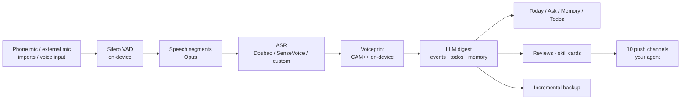

<div align="center">


# TaoSheng 涛声

**It listens, remembers, and thinks — for you.**

Just an Android phone: all-day listening → automatic transcription → knows who's speaking → AI turns it into todos, promises and memories.<br>
No hardware to buy. No account. Your data stays on your phone.

[](LICENSE)


[](https://github.com/0xCoach/TaoSheng/releases/download/v0.2.0/TaoSheng-v0.2.0-arm64.apk)

[简体中文](README.md) | English

</div>

---

## 🎬 Watch the 1:45 film

<div align="center">

<a href="docs/media/taosheng-film.mp4"></a>

👉 **[Watch the full film (1:45, with soundtrack)](docs/media/taosheng-film.mp4)**

</div>

> The app UI is currently in Chinese only.

## 💡 Why

You say thousands of sentences a day. How many do you remember?

Existing options either need a dedicated recorder (Omi, AI pendants, recording cards) or send all your audio to someone else's server. **TaoSheng uses the phone you already carry.** It quietly listens in the background, records only when someone is speaking, transcribes in batches, recognizes who said what, and lets an LLM organize it into events. When you need something, just ask — every answer links back to the original words.

## ✨ Highlights

1. **🎙 No hardware needed** — the phone mic is enough; lavalier / Bluetooth mics are auto-detected.
2. **📴 Fully offline transcription** — on-device SenseVoice (Snapdragon NPU), or Doubao cloud, or any custom ASR.
3. **⏱ Automatic transcribe + digest on your schedule** — every 15–720 minutes; review and skill times are configurable.
4. **🧑‍🤝‍🧑 Voiceprint, multiple speakers** — recognizes you and people you know; segments meetings by speaker.
5. **✅ Todos extracted automatically** — and marked done when you later say "sent it".
6. **🃏 Daily cards & custom skills** — meeting notes, check-in, weekly review, mood diary; add your own with JSON + a prompt.
7. **💬 Ask anything, with citations** — what you said or promised on any day, linked to the original lines.
8. **🤖 Feed your agent** — daily transcripts + digests (Markdown + JSON) pushed as diffs to 10 channels.
9. **☁️ Daily backup to WebDAV (Nutstore) and local** — incremental, 3 / 7 / 30-day versions, one-tap restore.
10. **🧠 Bring your own LLM** — any OpenAI-compatible endpoint, including fully self-hosted.
11. **🔒 Always on, even when locked** — foreground service + watchdog.
12. **🔋 Records only speech** — on-device VAD; ~0.5% battery per hour in testing.
13. **📺 Ignores media playback** and yields the mic to calls.
14. **⌨️ Remembers keyboard dictation** (optional) with chat context.
15. **🌙 Daily & weekly reviews**, pushed to you.
16. **🔁 Repeated ideas merged** ("mentioned N times").
17. **🔤 Hotwords**, **📂 audio import**, **🗂 timeline scrubbing & stars**.
18. **🔐 Privacy first** — no account, keys in Keystore, audio deleted 24h after transcription, never hidden from people around you.

<table>
<tr>
<td width="50%"></td>
<td width="50%"></td>
</tr>
<tr>
<td><b>🎙 Always listening, even when locked</b><br>Foreground service + watchdog. Records only when someone speaks (on-device Silero VAD), so it stays battery-friendly.</td>
<td><b>🧑‍🤝‍🧑 Knows who's talking</b><br>On-device voiceprint recognizes you and the people you know. Long-press any line and pick "who is this?" to teach it a new voice.</td>
</tr>
<tr>
<td></td>
<td></td>
</tr>
<tr>
<td><b>🧠 AI turns talk into things</b><br>Events, todos, appointments, decisions and ideas — sorted on a timeline.</td>
<td><b>💬 Ask, with citations</b><br>"What did I promise Wang last week?" An LLM with query tools searches your memory and cites the exact lines.</td>
</tr>
<tr>
<td></td>
<td></td>
</tr>
<tr>
<td><b>🃏 Skill cards</b><br>Meeting notes, end-of-day check-in, weekly review, mood diary. Each skill is a JSON + prompt you can write yourself.</td>
<td><b>🤖 Feed your own agent</b><br>Daily memory as Markdown + JSON, pushed as diffs (added / changed / deleted).</td>
</tr>
<tr>
<td></td>
<td></td>
</tr>
<tr>
<td><b>🌙 Daily & weekly reviews</b><br>Generated every night at 22:00 and every Sunday.</td>
<td><b>☁️ Daily incremental backup</b><br>Local + WebDAV (Nutstore), 3 / 7 / 30-day versions, one-tap restore on a new phone.</td>
</tr>
</table>

### More

- 📺 Skips transcription while the phone is playing video/music
- 🎧 Auto-switches to lavalier / Bluetooth mics, falls back when unplugged
- 🤝 Yields the mic to calls and voice messages
- 📂 Import audio files via "Share to TaoSheng"
- ⌨️ Optional: remembers what you dictate with your keyboard's voice input, plus the on-screen chat context (OCR in memory only)
- ☁️ Cloud ASR (Doubao), 📱 **on-device ASR** (SenseVoice on Snapdragon NPU — offline, free), or any custom endpoint
- 🔤 Hotwords for names and jargon
- 👥 Multi-speaker segmentation for meetings
- ✅ Todos: pending / in progress / done — say "sent it" and it knows the task is done
- 🔁 Repeated ideas merged into one ("mentioned N times")
- 📣 10 push channels: PushPlus, WeCom, ServerChan, Feishu, DingTalk, Telegram, Email, Notion, WebDAV/Obsidian folder, custom webhook
- 🔐 No account, no server of ours; API keys in Android Keystore; audio auto-deleted 24h after transcription; "forget the last N minutes"
- 👀 Never hidden: persistent notification and the system mic indicator stay visible
- 🔧 Every model is swappable — any OpenAI-compatible LLM, including self-hosted

## 🚀 Getting started

### Download

**v0.2.6** (2026-10-26, latest): [TaoSheng-v0.2.6-arm64.apk](https://github.com/0xCoach/TaoSheng/releases/download/v0.2.6/TaoSheng-v0.2.6-arm64.apk) (~88 MB) — step-by-step progress on the home page, long conversations get digested in time, configurable digest timing, faster voiceprint relabeling, one-time NPU check, retryable model downloads · [all releases](https://github.com/0xCoach/TaoSheng/releases)

arm64 Android 10+ only. SHA-256: `a557d5bb9a7056c79c813be3aa34ca4895fb450a886214de97d243bad241bec2`.

### Build from source


**You need:** Android 10+ (arm64; developed on Xiaomi 14 Pro / HyperOS 3), an ASR option (Doubao Speech API key, or on-device ASR), and an OpenAI-compatible LLM API key (DeepSeek by default).

```bash
git clone https://github.com/0xCoach/TaoSheng.git
cd TaoSheng
# Requires JDK 21 + Android SDK (compileSdk 36)
# Point org.gradle.java.home in gradle.properties to your JDK 21
echo "sdk.dir=/path/to/android-sdk" > local.properties
./gradlew assembleDebug
adb install -r app/build/outputs/apk/debug/app-debug.apk
```

First run:
1. Grant mic & notification permissions, whitelist battery, enable autostart (the in-app guide walks you through it on Xiaomi).
2. Settings → 原话与转写 (transcription): paste your Doubao key or choose local. Settings → 整理模型 (LLM): pick DeepSeek or a custom endpoint.
3. Settings → 声纹与人物 → 我: read three short passages to enroll your voice.
4. Turn on listening on the Today tab and live your day.
5. Optional: backup (数据备份) and push channels (推送通道).

## 🏗 How it works



Kotlin · Jetpack Compose · Room (SQLite + FTS4) · WorkManager · sherpa-onnx · Qualcomm QNN · Silero VAD · CAM++ · SenseVoice · pyannote.

## 🤖 Built by AI

Almost all code was written by AI: **Claude** did architecture, contracts and every screen; **Codex** did capture, ASR, database, push and backup. The human wrote requirements and tested on a real phone. All 48 task cards and delivery notes are public in [`docs/任务卡/`](docs/任务卡).

## ⚠️ Please note

TaoSheng is a personal memory tool. Recording conversations is regulated in many places — follow your local laws and tell people around you when required. The persistent notification and mic indicator are intentional; please don't turn this into covert recording software.

## 🙏 Acknowledgements

[Omi](https://github.com/BasedHardware/omi) · [sherpa-onnx](https://github.com/k2-fsa/sherpa-onnx) · [Silero VAD](https://github.com/snakers4/silero-vad) · [3D-Speaker / CAM++](https://github.com/modelscope/3D-Speaker) · [SenseVoice](https://github.com/FunAudioLLM/SenseVoice) · [pyannote](https://github.com/pyannote/pyannote-audio). Third-party sources and licenses: [`docs/third-party/`](docs/third-party).

## 📄 License

[MIT](LICENSE) © 2026 0xCoach
